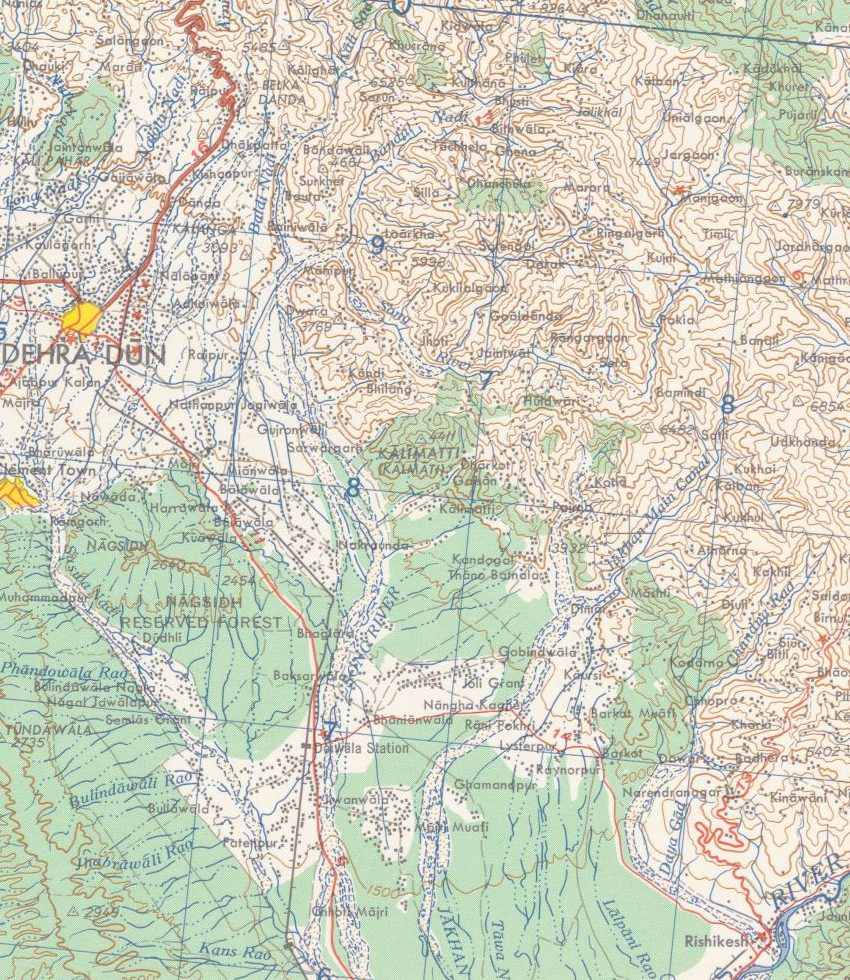
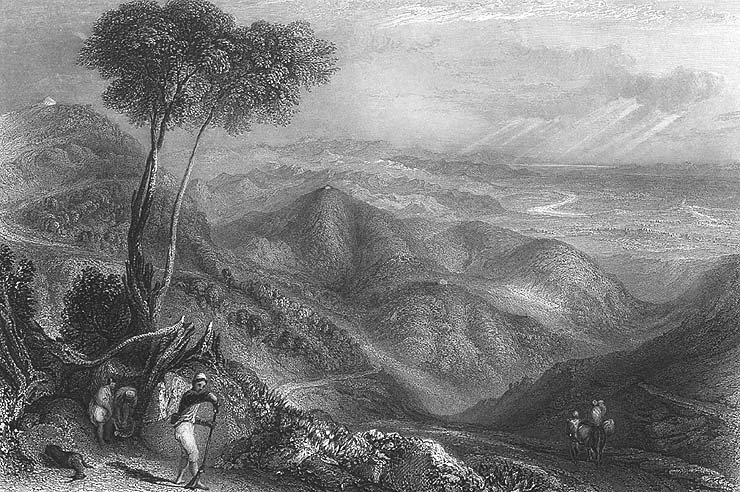
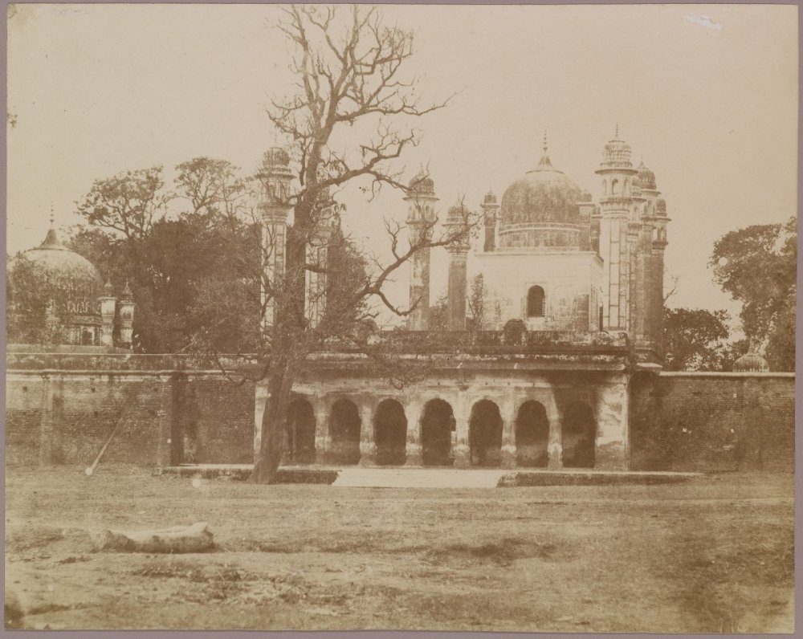

<!-- Draft. Outline and sources: ~/development/content/dehradun/outline.md. Sections 0-2 drafted (session 2, 2026-11-09); 3-10 to come. -->

I was born and brought up in Dehradun, back when it was a district of Uttar Pradesh. On 9 November 2000 it became the capital of a new state, the 27th state of India, named Uttaranchal.[^act00][^ukportal] The name was changed to Uttarakhand from 1 January 2007,[^act06] but I still like the old name more for what it means: *anchal* is the end of a mother's sari, the bit which shelters a child, so Uttaranchal is the lap of the north.

I also grew up reading Ruskin Bond, and the story which made me fall in love with him is "The Night Train at Deoli". A college boy goes up to his grandmother's place in Dehra every summer. On the way, at dawn, the train stops for ten minutes at Deoli, a small station with one platform, about thirty miles before Dehra, where the heavy jungle begins. A girl sells baskets on the platform, and that's the whole story, more or less.[^nighttrain]

There is no Deoli on the line. But thirty miles is almost exactly the distance from Dehra to Hardwar, which a guide book of 1884 puts at about 31 miles of dense jungle and long grass.[^northam] So Bond's made-up station sits roughly where the train leaves the valley and runs into the Siwalik forest, and the Dehra at the other end of that line is a quiet town of canals, mango and litchi orchards, and tree-lined roads.

The Dehradun of today has very little of that left. Drag the slider below and see for yourself.



*Figure 1. The Doon valley on 5 December 1989 (Landsat 5) and 14 November 2025 (Sentinel-2), same frame (77.90 to 78.15 E, 30.22 to 30.42 N) and same colour stretch. Drag the slider. Landsat 5 image courtesy of the U.S. Geological Survey; contains modified Copernicus Sentinel data 2025. Both read from Microsoft Planetary Computer.*

So, what happened to Bond's Dehra?

It turns out that the answer is mostly a story about water. The valley was made by water, people settled in it for water, and a set of small canals kept it green for two hundred years. Then, within a few decades, we covered the canals, filled the river beds with sewage and houses, and pumped the groundwater down. There is a second, smaller story about the shape of the valley: it is a bowl, and a bowl holds heat and smoke.

The easy villain is 9 November 2000, when a quiet town became a capital overnight, and the capital years did speed things up a lot. But the rot is older than the state.

<!-- FIGURE (download pending): 1955 US Army Map Service sheet NH 44-5, Wikimedia Commons, public domain. Crop to the town.

*Figure 2. Dehra Dun on the 1955 US Army Map Service sheet NH 44-5 (scale 1:250,000, i.e. 1 cm on the map is 2.5 km on the ground). The town is a small grid between the Bindal and the Rispana, with tea gardens and sal forest around it. U.S. Army Map Service, 1955; public domain, via University of Texas Libraries and Wikimedia Commons.*
-->

## A valley made by water

A *dun* (or *doon*) is the Hindi word for the flat valleys which lie along the foot of the Himalaya, between the main hills and a lower outer ridge called the Siwaliks; the one around Dehra is the best known, so much that it is often just called "the Dhoon".[^hobson] Babur, who came through in the 1520s, wrote that "the finest running water in Hindustân is that in this Dûn".[^hobson]

The valley is a block of land with a fault on every side: the Main Boundary Thrust on the north, where the Mussoorie hills begin, the Himalayan Frontal Thrust on the south, under the Siwaliks, and two tear faults on the east and west, along which the Ganga and the Yamuna cut through the Siwaliks.[^naquim] It is about 80 km long and 25 km wide. The Mussoorie range rose first, about 18 million years ago, and the low ground in front of it slowly filled up with whatever the rivers brought down. Then, only about half a million years ago, the Siwaliks were pushed up on the south side, and the valley as we know it came into existence.[^naquim] Half a million years is nothing for a mountain range; the 1916 update of the district gazetteer quotes geologists calling the Siwaliks "perhaps the most recently formed range of similar magnitude in the earth".[^walton1916]

Now think about what this does to the water. The Siwaliks act like a dam for rubble: everything the streams wash off the Himalaya gets trapped behind them, so the floor of the valley is raised well above the plains.[^walton-geo] That floor is made of fans of boulders, pebbles and sand, the 'Doon gravels', and it is very porous.[^cgwb2011] Even with heavy rain, the gazetteer of 1911 says, the soil is so porous that "without irrigation no good cultivation is possible", and "most of the streams dive into the earth at the foot of the hills" and come out again only at the lowest line of the valley, in the beds of the Asan, the Song and the Suswa.[^walton-geo]

<!-- FIGURE (to build): include dehradun/cross-section.svg, made by scripts/figs.py.

*Figure 3. Schematic, not measured data. A rough north-south cut through the valley at Dehra: the Mussoorie hills on the north, the gravel fans, the town on top of them, and the Siwaliks on the south. The heights are stretched to make the shape visible. Drawn from the descriptions in the 1911 gazetteer and the groundwater report of the Central Ground Water Board.*
-->

Dehra itself sits on a small plateau at about 2,300 ft (701 m), right on the line which divides the Ganga side of the valley from the Yamuna side.[^walton-rivers] Rain which falls a little west of the cantonment goes to the Yamuna; rain which falls on the town goes, through the Rispana and the Bindal and then the Suswa, to the Ganga. The Rispana on the east and the Bindal on the west were the two edges of the old town.[^walton-rivers]

And here is the first surprise. These two "rivers" were never rivers for most of the year. In 1911 both were "dry for nine months in the year", though "during the rains they carry a considerable volume of water".[^walton-rivers] Even in Bond's memory of the 1940s, his grandmother's house in Dalanwala was close to the dry bed of the Rispana.[^bond-coming] So, when someone says the Rispana used to be a full river and it dried up, it is not true. Something else has gone wrong with it.

The water was there, but deep down. When the British arrived in the 1820s, the officer in charge was told that digging a well in the Dun was "quite impossible". He dug one anyway near his office: it went down 228 ft (69 m) and cost over Rs 11,000, and by 1911 it was not in use.[^walton-wells] So, water at the surface came only from the streams which come out of the hills, and whoever controlled those streams controlled the valley.

There is one more thing the shape of the valley does. The Siwaliks stand between Dehra and the plains, and the gazetteer says they "partly suppress and partly moisten the scorching winds" of the plains, which is why Dehra was such a favourite place to live.[^walton-climate] A valley closed on both sides by hills is a bowl. In 1911 the bowl kept the heat out. Later in this story it starts doing the opposite.

<!-- FIGURE (download pending): "Valley of the Dhoon, Himalaya", 1850s print, Wikimedia Commons, PD-Art.

*Figure 4. "Valley of the Dhoon, Himalaya", a print from the 1850s: open valley, a few buildings, forest up to the hills. Unknown artist; public domain, via Wikimedia Commons.*
-->

## A town around a temple, and the water that decided a war

The town got its name from a camp. Ram Rai, a son of the seventh Sikh Guru, lost the succession to his younger brother, and after the execution of Guru Tegh Bahadur in 1675, Aurangzeb told him to retire to "the wilderness of the Dun" and stay out of public affairs.[^walton-history] He camped first across the Tons, then at Kharbara (today's Khurbura), and built his temple at Dhamuwala. The town which grew around it was called Gurudwara, or Dehra, from *dera*, a camp.[^walton-history] The date is a small mess: most accounts today say Ram Rai arrived in 1676, but the two old district histories both give 1699, and the gazetteer says the Gurudwara was built in 1699.[^ramrai-date] Either way, the capital of the valley was still at Nawada, on a hill a few miles south-east; only after 1770 did the seat of government move to the little town around the temple, "which now received and retained henceforth the name of Dehra".[^walton-history]

<!-- FIGURE (download pending): Tytler, "Guru Nanak's Temple, Dehra", c. 1857-58, National Gallery of Canada, PD. Wikimedia Commons.

*Figure 5. The Darbar of Guru Ram Rai in Dehra, photographed by Robert and Harriet Tytler around 1857-58. The town grew around this shrine. National Gallery of Canada; public domain, via Wikimedia Commons.*
-->

The water which kept that town alive is older than the town. The Rajpur canal takes off from the Rispana a little below Rajpur village and runs along the top of the ridge to Dehra.[^irrig-rajpur][^walton-canal] Tradition says it was built in the 17th century by Rani Karnavati, who ruled this part of Garhwal from Nawada, and the gazetteer says it was "originally designed to convey drinking water to the town of Dehra".[^walton-canal] In 1817 the mahant of Ram Rai's temple claimed to own the canal. The claim was thrown out on the ground that the Rani had lived before the temple existed.[^walton-canal] So, the canal which watered Dehra is not the Guru's, as many people in Dehradun believe; by tradition it came first. The British lined it with masonry between 1841 and 1844.[^irrig-rajpur] It was "formerly the sole source of Dehra's water supply", and by 1911 nearly every compound in the civil station had a fruit or vegetable garden watered by it.[^walton-canal]

The 18th century was rough on the valley. A Rohilla chief, Najib-ud-daula, ruled it from 1757 and dug canals and wells, and the old accounts speak well of him; when he died in 1770, "with him disappeared the prosperity of the Dun".[^walton-history] Sikh raiders came, then Najib's grandson, who sacked the Gurudwara in 1786. Then came the Gurkhas from Nepal. They took Dehra in October 1803, and the Raja of Garhwal, Pradhuman Sah, came back with about 12,000 men and was killed in battle at Kharbara in January 1804, i.e. in the same place where Ram Rai had camped a century earlier.[^walton-history] Gurkha rule "almost reduced the Dun to a desert". A British traveller in 1808 saw hill people, "from three to thirty years of age", sold as slaves at Hardwar for Rs 10 to 150 each, many hundreds a year, and the revenue of the valley fell from about Rs 1 lakh under Garhwal to never more than Rs 20,000 under the Gurkhas.[^walton-history]

Then the British came for the Gurkhas, and the war in the Doon was decided by water. In October 1814 a British general came into the valley with 3,500 men. The Gurkhas held Kalanga, a small fort on a spur about 3.5 miles north-east of Dehra, with three or four hundred regular soldiers and some Garhwali levies under Balbhadra Singh Thapa.[^walton-history] The first assault failed and the general was shot through the heart.[^walton-history] Heavy guns were brought from Delhi, and a second assault at the end of November also failed, with 4 officers and 33 men killed and 7 officers and 635 men wounded or missing. And then, in the gazetteer's words, "it was only now discovered that there was no water within the fort". The garrison drank from a spring outside the walls. The British cut it off, and on the night of 30 November Balbhadra and about 70 survivors walked out, by a step "which would have been equally feasible a month earlier".[^walton-history] That dry line is from an official British gazetteer, by the way.

The British put up two small white obelisks opposite the fort, side by side: one for their own dead, and one as "a tribute of respect for our gallant adversary", Balbhadra and his Gurkhas.[^williams-kalanga] It is not common for the winner to put up a memorial to the man it fought. And the spring which lost the Gurkhas their fort is the Nalapani spring, which gave the hill its popular name; its water was later piped to Dehra, and from 1889 it reached the town itself.[^walton-canal] On 17 November 1815 the Dun was annexed to the British district of Saharanpur.[^walton-history]

<!-- Sections 3-10 to be drafted. Charts built, not yet placed; move each into its section when drafting. Sources in each SVG's desc and in content/dehradun/scripts/figs.py. -->















---

## References

[^act00]: Uttar Pradesh Reorganisation Act, 2000, s. 3. [link](https://indiankanoon.org/doc/1885049/)

[^ukportal]: Government of Uttarakhand, state profile. [link](https://uk.gov.in/)

[^act06]: Uttaranchal (Alteration of Name) Act, 2006, in force 1 January 2007. [link](https://indiankanoon.org/doc/128596/)

[^nighttrain]: Ruskin Bond, "The Night Train at Deoli", title story of *The Night Train at Deoli and Other Stories*, Penguin India, New Delhi, 1988. [link](https://archive.org/details/nighttrainatdeol00bond)

[^northam]: John Northam, *Guide to Masuri, Landaur, Dehra Dun and the Hills North of Dehra*, Thacker, Spink, Calcutta, 1884, pp. 120-121. [link](https://archive.org/details/dli.pahar.1047)

[^hobson]: H. Yule and A. C. Burnell, *Hobson-Jobson*, entry "Dhoon", p. 314, quoting Babur's memoirs. [link](https://dsal.uchicago.edu/cgi-bin/app/hobsonjobson_query.py?qs=dhoon&searchhws=yes)

[^naquim]: Central Ground Water Board, *Aquifer Mapping and Management of Ground Water Resources, Dehradun District* (2021-22), pp. 34-35. [link](https://cgwb.gov.in/old_website/AQM/NAQUIM_REPORT/Uttarakhand/Dehradun%20Final.pdf)

[^walton1916]: *Dehra Dun District Gazetteer, Alterations and Additions to Part A* (1916), p. 1, quoting Burrard and Hayden. [link](https://archive.org/details/in.ernet.dli.2015.281349)

[^walton-geo]: H. G. Walton, *Dehra Dun: A Gazetteer*, District Gazetteers of the United Provinces, vol. I, Government Press, Allahabad, 1911, pp. 1, 12-13 and 43. [link](https://archive.org/details/in.ernet.dli.2015.263385)

[^cgwb2011]: Central Ground Water Board, *Ground Water Brochure, District Dehradun*, June 2011, sections 3.1.2 and 4.1.1.3. [link](https://cgwb.gov.in/sites/default/files/2022-10/dehradun.pdf)

[^walton-rivers]: Walton 1911 (as above), pp. 2-3, 9 and 211.

[^bond-coming]: Ruskin Bond, "Coming Home to Dehra", in *Our Trees Still Grow in Dehra*, Penguin India, New Delhi, 1991, p. 43. [link](https://archive.org/details/ourtreesstillgro0000bond)

[^walton-wells]: Walton 1911 (as above), pp. 43-44.

[^walton-climate]: Walton 1911 (as above), pp. 36-37.

[^walton-history]: Walton 1911 (as above), pp. 172-183.

[^ramrai-date]: G. R. C. Williams, *Historical and Statistical Memoir of Dehra Doon*, Thomason College Press, Roorkee, 1874, para 175, p. 90, and Walton 1911, pp. 214 and 221, both give 1699 (Samvat 1756). Walton's history chapter (p. 172) puts the arrival in the reign of Medini Sah, which fits an earlier date. [link](https://archive.org/details/in.ernet.dli.2015.19839)

[^irrig-rajpur]: Uttarakhand Irrigation Department, "Rajpur Canal". [link](https://uttarakhandirrigation.com/rajpur-canal)

[^walton-canal]: Walton 1911 (as above), pp. 47 and 216-217, and p. 230 for the Nalapani spring.

[^williams-kalanga]: Williams 1874 (as above), paras 284-287, pp. 134-136, with the inscriptions in a footnote.
