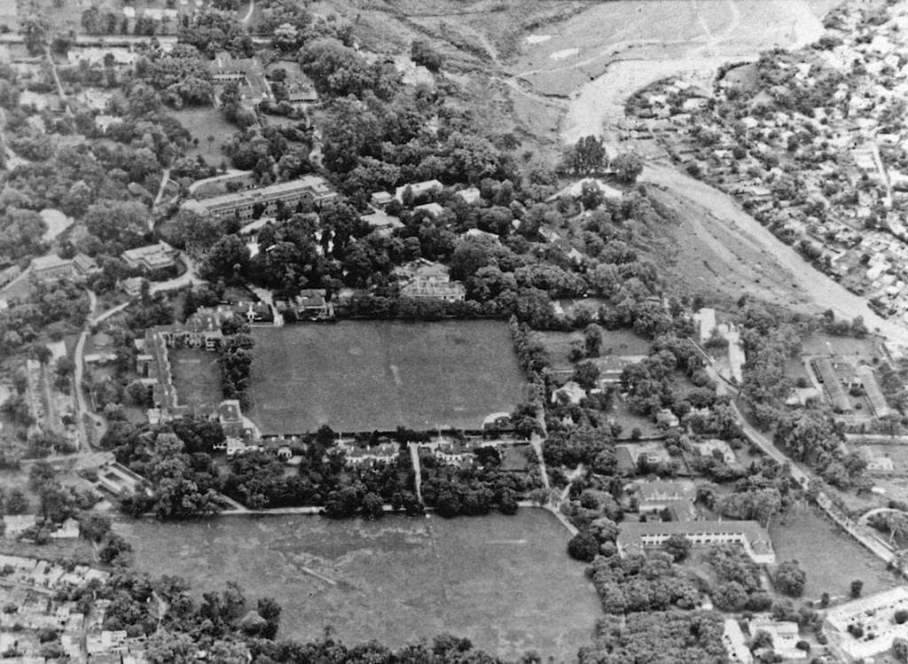
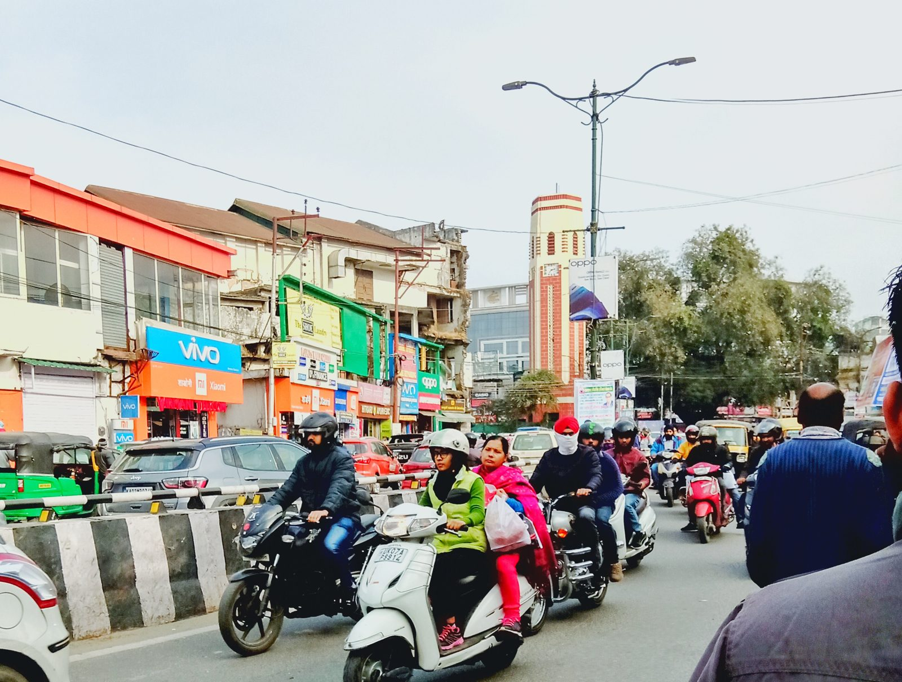
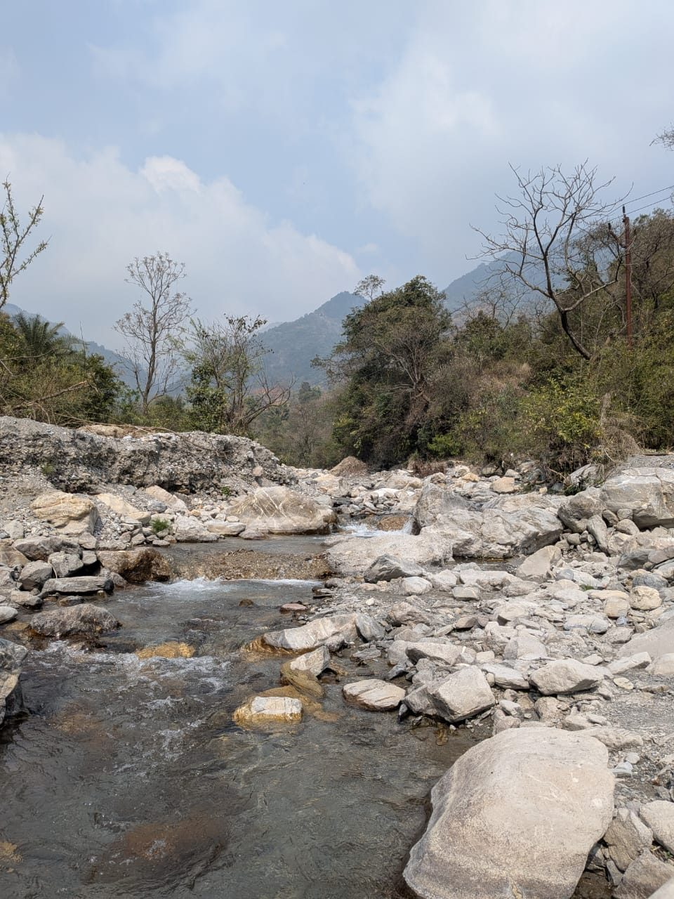
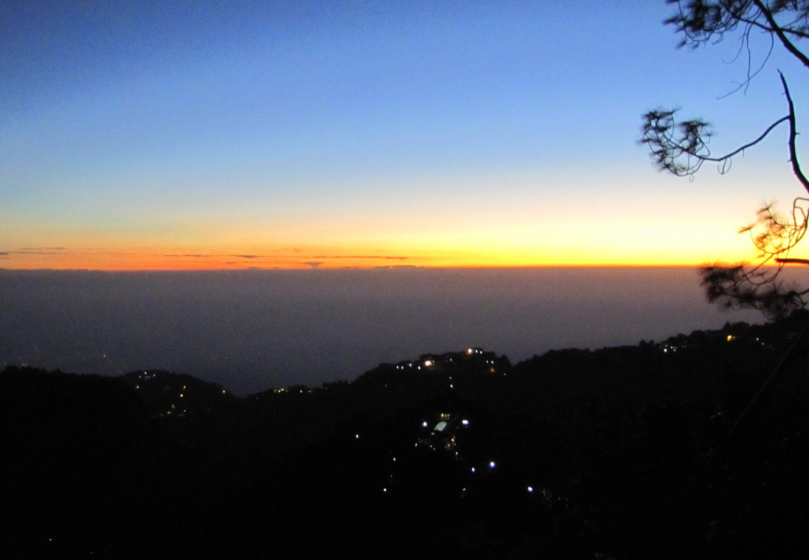

<!-- Draft. Outline and sources: ~/development/content/dehradun/outline.md. Sections 0-2 drafted (session 2, 2026-11-09); 3-10 to come. -->

I was born and brought up in Dehradun, back when it was a district of Uttar Pradesh. On 9 November 2000 it became the capital of a new state, the 27th state of India, named Uttaranchal.[^act00][^ukportal] So, I was born in one state, but my conscious birth was in Uttaranchal, and that is why Uttaranchal is always close to my heart. Its name was changed to Uttarakhand from 1 January 2007,[^act06] but I still like the old name more for what it means: *anchal* is the end of a mother's sari, the bit which shelters a child, so Uttaranchal is the lap of the north.

I also grew up reading Ruskin Bond, and the story which made me fall in love with him is "The Night Train at Deoli". A college boy goes up to his grandmother's place in Dehra every summer. On the way, at dawn, the train stops for ten minutes at Deoli, a small station with one platform, about thirty miles before Dehra, where the heavy jungle begins. A girl sells baskets on the platform, and that's the whole story, more or less.[^nighttrain]

There is no Deoli on the line. But thirty miles is almost exactly the distance from Dehra to Hardwar, which a guide book of 1884 puts at about 31 miles of dense jungle and long grass.[^northam] So Bond's made-up station sits roughly where the train leaves the valley and runs into the Siwalik forest, and the Dehra at the other end of that line is a quiet town of canals, mango and litchi orchards, and tree-lined roads.

The Dehradun of today has very little of that left. Drag the slider below and see for yourself.



*Figure 1. The Doon valley on 5 December 1989 (Landsat 5) and 14 November 2025 (Sentinel-2), same frame (77.90 to 78.15 E, 30.22 to 30.42 N) and same colour stretch. Drag the slider. Landsat 5 image courtesy of the U.S. Geological Survey; contains modified Copernicus Sentinel data 2025. Both read from Microsoft Planetary Computer.*

So, what happened to Bond's Dehra?

It turns out that the answer is mostly a story about water. The valley was made by water, people settled in it for water, and a set of small canals kept it green for two hundred years. Then, within a few decades, we covered the canals, filled the river beds with sewage and houses, and pumped the groundwater down. There is a second, smaller story about the shape of the valley: it is a bowl, and a bowl holds heat and smoke.

The easy villain is 9 November 2000, when a quiet town became a capital overnight, and the capital years did speed things up a lot. But the rot is older than the state.

*Figure 2. The eastern half of the Doon on the 1955 US Army Map Service sheet NH 44-5, at a scale of 1:250,000, i.e. 1 cm on the map is 2.5 km on the ground. Dehra Dun is the small yellow patch on the left edge of the sheet; Nawada and the Nagsidh forest are just south of it, and Rishikesh is at the bottom right, where the Ganga leaves the hills. Green is forest. U.S. Army Map Service, 1955; public domain, via University of Texas Libraries and Wikimedia Commons; cropped.*

## A valley made by water

A *dun* (or *doon*) is the Hindi word for the flat valleys which lie along the foot of the Himalaya, between the main hills and a lower outer ridge called the Siwaliks; the one around Dehra is the best known, so much that it is often just called "the Dhoon".[^hobson] Babur, who came through in the 1520s, wrote that "the finest running water in Hindustân is that in this Dûn".[^hobson]

The valley is a block of land with a fault on every side: the Main Boundary Thrust on the north, where the Mussoorie hills begin, the Himalayan Frontal Thrust on the south, under the Siwaliks, and two tear faults on the east and west, along which the Ganga and the Yamuna cut through the Siwaliks.[^naquim] It is about 80 km long and 25 km wide. The Mussoorie range rose first, about 18 million years ago, and the low ground in front of it slowly filled up with whatever the rivers brought down. Then, only about half a million years ago, the Siwaliks were pushed up on the south side, and the valley as we know it came into existence.[^naquim] Half a million years is nothing for a mountain range; the 1916 update of the district gazetteer quotes geologists calling the Siwaliks "perhaps the most recently formed range of similar magnitude in the earth".[^walton1916]

Now think about what this does to the water. The Siwaliks act like a dam for rubble: everything the streams wash off the Himalaya gets trapped behind them, so the floor of the valley is raised well above the plains.[^walton-geo] That floor is made of fans of boulders, pebbles and sand, the 'Doon gravels', and it is very porous.[^cgwb2011] Even with heavy rain, the gazetteer of 1911 says, the soil is so porous that "without irrigation no good cultivation is possible", and "most of the streams dive into the earth at the foot of the hills" and come out again only at the lowest line of the valley, in the beds of the Asan, the Song and the Suswa.[^walton-geo]



*Figure 3. Schematic, not measured data. A rough north-south cut through the valley at Dehra: the Mussoorie hills on the north, the gravel fans, the town on top of them, and the Siwaliks on the south. The heights are stretched to make the shape visible. Drawn from the descriptions in the 1911 gazetteer and the groundwater report of the Central Ground Water Board.*

Dehra itself sits on a small plateau at about 2,300 ft (701 m), right on the line which divides the Ganga side of the valley from the Yamuna side.[^walton-rivers] Rain which falls a little west of the cantonment goes to the Yamuna; rain which falls on the town goes, through the Rispana and the Bindal and then the Suswa, to the Ganga. The Rispana on the east and the Bindal on the west were the two edges of the old town.[^walton-rivers]

And here is the first surprise. These two "rivers" were never rivers for most of the year. In 1911 both were "dry for nine months in the year", though "during the rains they carry a considerable volume of water".[^walton-rivers] Even in Bond's memory of the 1940s, his grandmother's house in Dalanwala was close to the dry bed of the Rispana.[^bond-coming] So, when someone says the Rispana used to be a full river and it dried up, it is not true. Something else has gone wrong with it.

The water was there, but deep down. When the British arrived in the 1820s, the officer in charge was told that digging a well in the Dun was "quite impossible". He dug one anyway near his office: it went down 228 ft (69 m) and cost over Rs 11,000, and by 1911 it was not in use.[^walton-wells] So, water at the surface came only from the streams which come out of the hills, and whoever controlled those streams controlled the valley.

There is one more thing the shape of the valley does. The Siwaliks stand between Dehra and the plains, and the gazetteer says they "partly suppress and partly moisten the scorching winds" of the plains, which is why Dehra was such a favourite place to live.[^walton-climate] A valley closed on both sides by hills is a bowl. In 1911 the bowl kept the heat out. Later in this story it starts doing the opposite.

*Figure 4. "Valley of the Dhoon, Himalaya", an engraving from the 1850s, looking down from the hills onto the flat valley floor with the Siwaliks beyond. Unknown artist; public domain, via Wikimedia Commons.*

## A town around a temple, and the water that decided a war

The town got its name from a camp. Ram Rai, a son of the seventh Sikh Guru, lost the succession to his younger brother, and after the execution of Guru Tegh Bahadur in 1675, Aurangzeb told him to retire to "the wilderness of the Dun" and stay out of public affairs.[^walton-history] He camped first across the Tons, then at Kharbara (today's Khurbura), and built his temple at Dhamuwala. The town which grew around it was called Gurudwara, or Dehra, from *dera*, a camp.[^walton-history] The date is a small mess: most accounts today say Ram Rai arrived in 1676, but the two old district histories both give 1699, and the gazetteer says the Gurudwara was built in 1699.[^ramrai-date] Either way, the capital of the valley was still at Nawada, on a hill a few miles south-east; only after 1770 did the seat of government move to the little town around the temple, "which now received and retained henceforth the name of Dehra".[^walton-history]

*Figure 5. The Darbar of Guru Ram Rai in Dehra, photographed by Robert and Harriet Tytler around 1857-58. The town grew around this shrine. National Gallery of Canada; public domain, via Wikimedia Commons.*

The water which kept that town alive is older than the town. The Rajpur canal takes off from the Rispana a little below Rajpur village and runs along the top of the ridge to Dehra.[^irrig-rajpur][^walton-canal] Tradition says it was built in the 17th century by Rani Karnavati, who ruled this part of Garhwal from Nawada, and the gazetteer says it was "originally designed to convey drinking water to the town of Dehra".[^walton-canal] In 1817 the mahant of Ram Rai's temple claimed to own the canal. The claim was thrown out on the ground that the Rani had lived before the temple existed.[^walton-canal] So, the canal which watered Dehra is not the Guru's, as many people in Dehradun believe; by tradition it came first. The British lined it with masonry between 1841 and 1844.[^irrig-rajpur] It was "formerly the sole source of Dehra's water supply", and by 1911 nearly every compound in the civil station had a fruit or vegetable garden watered by it.[^walton-canal]

The 18th century was rough on the valley. A Rohilla chief, Najib-ud-daula, ruled it from 1757 and dug canals and wells, and the old accounts speak well of him; when he died in 1770, "with him disappeared the prosperity of the Dun".[^walton-history] Sikh raiders came, then Najib's grandson, who sacked the Gurudwara in 1786. Then came the Gurkhas from Nepal. They took Dehra in October 1803, and the Raja of Garhwal, Pradhuman Sah, came back with about 12,000 men and was killed in battle at Kharbara in January 1804, i.e. in the same place where Ram Rai had camped a century earlier.[^walton-history] Gurkha rule "almost reduced the Dun to a desert". A British traveller in 1808 saw hill people, "from three to thirty years of age", sold as slaves at Hardwar for Rs 10 to 150 each, many hundreds a year, and the revenue of the valley fell from about Rs 1 lakh under Garhwal to never more than Rs 20,000 under the Gurkhas.[^walton-history]

Then the British came for the Gurkhas, and the war in the Doon was decided by water. In October 1814 a British general came into the valley with 3,500 men. The Gurkhas held Kalanga, a small fort on a spur about 3.5 miles north-east of Dehra, with three or four hundred regular soldiers and some Garhwali levies under Balbhadra Singh Thapa.[^walton-history] The first assault failed and the general was shot through the heart.[^walton-history] Heavy guns were brought from Delhi, and a second assault at the end of November also failed, with 4 officers and 33 men killed and 7 officers and 635 men wounded or missing. And then, in the gazetteer's words, "it was only now discovered that there was no water within the fort". The garrison drank from a spring outside the walls. The British cut it off, and on the night of 30 November Balbhadra and about 70 survivors walked out, by a step "which would have been equally feasible a month earlier".[^walton-history] That dry line is from an official British gazetteer, by the way.

The British put up two small white obelisks opposite the fort, side by side: one for their own dead, and one as "a tribute of respect for our gallant adversary", Balbhadra and his Gurkhas.[^williams-kalanga] It is not common for the winner to put up a memorial to the man it fought. And the spring which lost the Gurkhas their fort is the Nalapani spring, which gave the hill its popular name; its water was later piped to Dehra, and from 1889 it reached the town itself.[^walton-canal] On 17 November 1815 the Dun was annexed to the British district of Saharanpur.[^walton-history]

## The green century

The British spent the next hundred years doing what Najib had started: bringing the hill water down onto the valley floor. When they looked at the canals in 1823, many of them had been neglected for so long that the villages which depended on them had been deserted, and in 1826 the gardens of Dehra were taxed to pay for repairs.[^walton-canals] Then came new ones. The Bijapur canal, taken off the Tons, was designed in 1837 and carried water from January 1841;[^irrig-bijapur] the Katapathar canal on the Yamuna was designed in 1840-41 and finished in 1847; the Kalanga canal came in 1859-60 and the Jakhan canal in 1863-64.[^walton-canals] By 1885 the valley had 67 miles of government canals, and by 1911 about 83 miles.[^walton-canals]

These were small things. The gazetteer calls them "the merest runnels" next to the canals of the plains, but it also says that the very existence of the villages, except those next to a perennial stream, "depends upon the canals".[^walton-canals] It was a good deal for a farmer too: a tenant with 3 or 4 acres of canal land could also farm 10 to 12 acres of dry land.[^walton-canals] The masonry also kept failing for a funny reason: the valley was full of land crabs, which bored through the lime mortar to get to the water lol.[^walton-canals]

In the town the Rajpur canal split near Dilaram Bazaar and ran open through the civil station and the old town, and the gazetteer calls it "the cause of the verdure which makes Dehra at all times one of the prettiest stations in India". The bigger compounds sold their fruit and vegetables in Mussoorie and earned Rs 100 to 250 a year from it.[^walton-canal] The valley's rice had a name already; the gazetteer lists *bansmati* as "the best of all" the rices grown here.[^walton-rice] There were tea gardens too. A government tea farm at Kaulagir was running before 1840, and at the peak, in 1881, the valley had 87 tea gardens on 4,468 acres, selling green tea to traders from Kabul and Central Asia; the business declined after 1882.[^walton-tea]

So, what did a summer in this valley feel like? The gazetteer of 1911 says "only the months of May and June are at all oppressive", and "There is almost an English spring, and the rains are by no means unpleasant. As a rule there is a good downfall once a day, and the air is always cool."[^walton-climate] There was even a complaint about too many trees: the compounds were so full of mango and litchi trees that the gazetteer blamed them for blocking the air and for the fever of August and September.[^walton-climate] Read that line again in 2026.

The town also collected institutions. The computing office of the Great Trigonometrical Survey moved here in 1861, the Forest School opened in 1878 and became the Imperial Forest Research Institute in 1906,[^walton-inst] the railway from Hardwar arrived in 1900,[^walton-rail] the Indian Military Academy opened in 1932,[^ima] and the Doon School opened in 1935 on the site of the old forest institute.[^doonschool] They came with big green campuses; the forest institute alone sits on about 450 ha.[^fri]

*Figure 6. The old Forest Research Institute estate from the air on 7 March 1922; after the institute moved to its new building in 1929, this estate became the Doon School. Look at the open ground, the trees around every house, and the wide, dry stream bed at the top right. Unknown photographer, Doon School archives; public domain, via Wikimedia Commons.*

This is the Dehra Bond grew up in during the 1940s. In his stories the boys cycle to a canal full of snow water from the hills, the bungalows are surrounded by mango, litchi and jackfruit trees, and a ten-minute tonga ride takes you to the bazaar.[^bond-roof][^bond-tonga]

## The rot is older than we think

It is easy to blame everything on the capital. But the first official complaint that Dehra was getting hotter is from 1911. Hot winds, the gazetteer says, "now accompany the advent of the summer months", become "annually more marked and prolonged", and "are doubtless due to the rapid clearances of tree jungle". And then this line: "These warm breezes were unknown in Dehra before 1873."[^walton-heat] So, the link between cutting trees and a hotter Dehra was written down by a British district officer more than a hundred years ago.

The first property boom is from the same years. After the railway came in 1900, pensioners flocked to Dehra, and for a while two or three families shared one house. In 1904 the Nashville estate, a single house on 85 bighas, was sold for Rs 20,000 and cut into plots; by 1911 it had seven more bungalows, and one of them, "built of the cheapest possible materials", was sold with a small plot for Rs 20,000, i.e. the price of the whole original estate. "Small cramped modern houses" came up along the Eastern Canal Road and Lytton Road, and the old bungalows with hedges of wild roses were already "in a rapidly decreasing minority". By 1911 more houses had been built than were needed, and there was "a distinct slump in the building trade".[^walton-boom] Speculation, cutting big plots into small ones, building along the canal roads: none of this is new. Only the scale is.

Then came Partition. The 1951 census counted 48,080 refugees in the district, about 13% of its people, most of them in Dehra Dun city, and the city grew 84% in that one decade.[^census51] The census itself calls the growth of the district "phenomenal" and puts it down chiefly to people moving in.[^census51] Figure 7 shows how this adds up over a century: from 1901 to 2011 the district grew 9.6 times, while Uttarakhand and India each grew about 5.1 times.



*Figure 7. Population of Dehradun district, Uttarakhand and India from 1901 to 2011, each divided by its own 1901 population, so 2x means double. The dashed line marks November 2000, when Dehradun became the capital. Data: Census of India 2011, Table A-02.[^censusA02]*

In the 1980s the hills around the valley were being quarried for limestone, and the case went all the way to the Supreme Court. In 1985 the court called it "the first case of its kind in the country involving issues relating to environment and ecological balance", and started closing the quarries.[^rlek85] Its final judgment in 1988 explains why it mattered for the water: the limestone had acted as aquifers, i.e. rock which holds water and feeds the springs, and after the forest was cut and the hills were quarried, "the aquifers ceased to exist" and the streams got blocked by stones and scree.[^rlek88] On 1 February 1989 the central government declared the Doon valley a protected area under the Environment Protection Act: industry, mining, tourism and grazing were restricted, and land in the valley could be used only according to a Master Plan approved by the Ministry of Environment.[^doonnotif] Remember this notification; it is still law.

And the planning was failing well before 2000. The first Master Plan for Dehradun covered 1982 to 2001 and planned for about 6 lakh people; in 2001 the urban area had about 5.6 lakh.[^mp2025] So, the planners got the population about right. What they could not hold was the land. By 2003-04, 2,210 ha, i.e. 31% of all the land the plan had marked for urban use, had been developed against the plan, through permissions from the development authority and 23 separate government notifications between 1986 and 2005.[^mp2025] The biggest loser was farmland: 860 ha, of which 740 ha became housing (Figure 8). Forest, green belt, drains and even a sewage farm were built over.



*Figure 8. Land in Dehradun developed against the 1982-2001 Master Plan by 2003-04, by what the plan had marked it for, in hectares (1 ha is 100 m by 100 m). Red is the part which became housing. "Other" is community facilities, transport, a sewage farm and unmarked land. Data: Dehradun Master Plan 2005-2025, Table 2.3.[^mp2025]*

## Capital

Then came 9 November 2000. A town which was already growing too fast became the seat of a state government overnight, with its offices, its staff, and everyone who wants to be near them. In the first decade of the capital, 2001 to 2011, the district grew 32.3%, against 18.8% for the state and 17.7% for India.[^censusA02] By 2011, 52.7% of the people in the district, i.e. 8.94 lakh, had come from somewhere else, and 3.7 lakh of them had arrived in the last ten years.[^census-d02] (This count includes women who moved after marriage, so it is not all job migration.) The Dehradun urban agglomeration had 706,124 people in 2011.[^census-a4]

The planners themselves wrote down what happened next. The Master Plan for 2005-2025 says that after Dehradun was made the interim capital, land prices rose very steeply, land changed hands fast, and the town spread without a plan; it lists the results as loss of green areas, encroachment on rivers and drains, roads and services which no longer match the housing, and loss of farmland.[^mp2025-ch1] That plan was notified in 2008 without the Ministry of Environment's approval which the 1989 notification requires, and in 2018 the High Court quashed it.[^livelaw] By 2021, out of the 1,008 ha which the plan had reserved for parks and recreation, only 138 ha existed.[^mp2041] When I was growing up we had playgrounds; today you hardly see any.

In April 2018 the government added 72 villages to the municipal corporation, about 132 sq km with 1.95 lakh people, and the city's legal area went from 64.6 sq km to 196.5 sq km, with 100 wards.[^villages][^nagarnigam] Figure 1 at the top shows what all this growth looks like from above. A satellite study of the western Doon puts numbers on it: between 1989 and 2020 the built-up area went from 44.4 sq km to 154.4 sq km, i.e. it grew about 3.5 times, open and scrub land fell from 72.9 to 9.8 sq km, and water bodies fell from 30.3 to 7.1 sq km (Figure 9).[^thapa2021]



*Figure 9. Land use on the floor of the western Doon (931 sq km around Dehradun and Mussoorie) in 1989 and 2020, in sq km, read from Landsat images. Data: Thapa and Bahuguna, 2021.[^thapa2021]*

Not everyone who came got a house. In 2009 the city listed 129 slums with about 1.65 lakh people, i.e. 28.6% of the town,[^dchb] and many of them sit on the beds of the Rispana and the Bindal, which is where the next part of this story goes.

And then the cars. Around 2003 Dehradun had about 1.8 lakh registered vehicles, and the city had only 30 km of road wider than 10 m.[^mp2025-traffic] New registrations went from 16,178 in 2000 to 56,121 in 2011-12.[^pioneer2013] By April 2025 more than 10.5 lakh vehicles were registered in the city, and buses, autos and cabs together were only 2.3% of them.[^dte-vehicles]

*Figure 10. Traffic on Chakrata Road near the Clock Tower, December 2019. Photo: ArmouredCyborg, CC BY-SA 4.0, via Wikimedia Commons.*

So, where did the space for all these vehicles come from? Partly from the canals.

## Burying the canals, filling the rivers, emptying the ground

After Dehradun became the capital, the state government decided to put the city's canals underground, "mainly to ease city traffic". By November 2008 about 20 km of a 52 km network was already under the road, for about Rs 10.9 crore, and the irrigation department proposed more.[^tribune2008] The roads built over them, the East Canal Road and GMS Road, were by then among the widest in the city.[^tribune2008] The department had its own reasons too: covered canals lose less water, and the open ones had become garbage dumps.[^tribune2008] In 2014 work started on covering about 5 km of the Kalanga canal between Maldevta and Raipur.[^pioneer2014]



*Figure 11. Stretches of Dehradun's canals already put underground by November 2008, with the roads they run under, in km. Data: The Tribune, 27 November 2008.[^tribune2008]*

There was a canal along Mata Mandir Road when I was growing up, a branch of the old Rajpur canal; by the late 2000s it was gone. In Bond's Dehra, the canal went under the town and came out again: "The canal comes down from Rajpur and goes underground here", he wrote, and it came out about a mile further on.[^bond-trees] In today's Dehradun it mostly does not come out at all. And I think this is the single worst decision in this whole story. The garbage problem was real, but a garbage problem in a canal is solved by cleaning the canal; what the city did was to give away the one thing which had made it green for two hundred years, and it did that to make space for cars.

The two seasonal rivers fared no better. Remember that the Rispana and the Bindal were always dry for most of the year. To the 1911 gazetteer, the dry bed was part of the river: in the rains a torrent spreads over the whole bed, eats into its banks, and the next year picks a new channel somewhere else in it.[^walton-rivers] So, a dry river bed is not empty land; it is where the next flood goes. Today houses stand in those beds. A survey for the High Court counted about 106 ha of river bed encroached in the district, 37.9 ha of it in the Dehradun tehsil,[^hc2022] and about 56% of the city's slum population lives along the Rispana and its streams.[^chauniyal2024] In the night of 15-16 September 2025, cloudbursts and heavy rain killed 13 people in Dehradun district; Sahastradhara got 192 mm of rain that night, and Dalanwala, on the bank of the Rispana, was among the worst hit areas.[^tribune2025]

*Figure 12. The Rispana at Raipur village, upstream of the city, in April 2026. Further down, in the city, the same bed carries sewage. Photo: Nagarpedian, CC BY-SA 4.0, via Wikimedia Commons.*

What does flow in the beds outside the monsoon is sewage. Around 2000 only 40% of the city had sewer lines, and the Master Plan says plainly, "There is no sewage treatment arrangement in the city."[^mp2025-sewage] By 2025 the city made about 118 MLD (million litres a day) of sewage and treated about 70 MLD of it, so about 48 MLD, i.e. 41%, still went out untreated.[^ngt606] Below the city, the Suswa, which the Rispana and the Bindal flow into, is in the worst class of polluted rivers in the country, with a BOD of up to 37 mg/L.[^cpcb2018] BOD is the amount of oxygen which bacteria use up to eat the dirt in the water, so a higher number means dirtier water; for a river to be fit for bathing it should be at most 3 mg/L.[^cpcb2018] So the Suswa below Dehradun is about 12 times over that. I have watched the Rispana's monsoon flow shrink over the years; what has grown in its bed is houses and sewage.

The third water was the one underground, the one the officers of the 1820s could not reach. In 1969-70 the whole district had 4 tube wells.[^upgaz1979] By 2009 about 200 tube wells were working in the valley, the city's water supply was running 84 schemes based on tube wells, and the groundwater board listed "heavy exploitation of ground water from deeper aquifer in Doon Valley" as the main problem.[^cgwb2011-gw] The board's latest report on the district says water levels are "rising". But the board's own monitoring well at its own office in Dehradun tells another story: the water there was 49.5 m below the ground in 2010 and 61.1 m below in 2022 (Figure 13).[^naquim-gw][^gwyb] The same report explains why: building and concreting the open ground has cut how much rain soaks into the ground.[^naquim-gw]



*Figure 13. Depth to groundwater before the monsoon at the Central Ground Water Board's monitoring well at its office in Dehradun, in metres below the ground; the line goes down as the water goes deeper. The 2021 value is shown as printed, though it breaks the pattern. Data: CGWB aquifer mapping report for Dehradun (2021-22) and Ground Water Year Book 2022-23.[^naquim-gw][^gwyb]*

And after all this pumping, the city's water system produces about 178 MLD, but because of leaks only about 71 MLD reaches people's taps; each person gets about 114 litres a day,[^naquim-supply] i.e. a little less than the 118 litres a day of 1969-70.[^upgaz1979]

## The bowl heats up

In 1911 the bowl kept the hot winds of the plains out. Now look at what the weather station at Dehradun has recorded. In 1993-2002 the station had on average about 35 days a year with a maximum of 35 °C or more; in 2015-2024 it had about 58.[^gsod] The average daily maximum went up by about 0.77 °C every ten years.[^gsod] 2024 was the worst so far: 76 days at or above 35 °C, a peak of 43.2 °C, 39 nights which did not cool below 25 °C (the most in the record), and 7 of the 12 hottest days the station has ever recorded.[^gsod] When I was growing up a fan was enough in summer.



*Figure 14. Days in each year when the maximum temperature at the Dehradun weather station reached 35 °C or more, 1993 to 2024, for years with at least 330 days of records. The dashed lines are the averages for 1993-2002 and 2015-2024. Data: NOAA Global Summary of the Day, station 42111.[^gsod]*

Two things in fairness. The all-time record at Dehradun is still 43.9 °C, on 4 June 1902, so 2024 did not break it.[^imd2012] And the station data and a weather-model reconstruction of the same place do not agree on whether the days or the nights have warmed more; the safe thing to say is that Dehradun is clearly warmer than it was in the 1990s.[^gsod] The India Meteorological Department itself, in its 2012 booklet on the climate of Dehra Dun, wrote that the basmati, the litchi, the tea gardens, the sal forests and the canals for which the town was famous were "disappearing at a very fast pace and thereby also changing its microclimate".[^imd2012] That is the weather office saying it, not an activist.

The bowl also holds smoke and dust. Dehradun is one of the three cities in Uttarakhand which do not meet the national air standard.[^crea2026] Between 2015 and 2021 the yearly average of PM10, the dust particles smaller than 10 micrometres which get into our lungs, was between 2 and 4 times the national limit of 60 micrograms per cubic metre every single year (Figure 15).[^kansal2023] The official numbers since then show improvement: from 250 in 2017-18 to 109 in 2023-24, still about 1.8 times the limit.[^pib2024]



*Figure 15. Yearly average of PM10 (dust particles smaller than 10 micrometres) in Dehradun's air, 2015 to 2021, from the three monitoring stations at the Clock Tower, ISBT and Raipur Chowk, in micrograms per cubic metre. The dashed line is the national annual limit of 60. 2020 is the lockdown year. Data: Kansal et al., 2023.[^kansal2023]*

*Figure 16. The 'winterline' over the Doon valley, seen from Mussoorie in November 2010: a flat band of haze lying over the valley floor. Photo: Paul Hamilton, CC BY-SA 2.0, via Wikimedia Commons.*

## Trees

If you look up the official forest cover of Dehradun district, you will find that it has not changed: about 1,607 sq km, i.e. 52%, in 2011, and about 1,640 sq km, i.e. 53%, in 2023.[^isfr] So, where is the loss? It turns out that the Forest Survey counts as 'forest' any patch bigger than 1 ha where tree crowns cover at least 10% of the ground, whoever owns it, so plantations, orchards and tea gardens with shade trees all count.[^isfr] A district which includes the Chakrata hills can keep its number steady while the valley floor loses its trees. The satellite study of the western Doon from Figure 9 finds 15.6 sq km of forest and trees lost between 1989 and 2020.[^thapa2021]

And the felling goes on, one project at a time. The 16 km of the Delhi-Dehradun expressway near the city took 7,575 trees, 4,983 of them in Uttarakhand.[^expressway] About 2,057 trees were proposed for the widening of the Sahastradhara road.[^sahastradhara] Around 2,000 sal trees in the Khalanga forest were marked for a water treatment plant, which was moved elsewhere after protests in 2024,[^khalanga] and in July 2026 the widening of the road to Rishikesh at Saat Mod was cutting or moving 4,369 trees, mostly sal.[^saatmod]



*Figure 17. Trees cut, or approved or proposed for cutting, for four projects around Dehradun; each bar says which. Data: NHAI reply to an RTI request (expressway), court and news reports (others); see the footnotes.*

"Our trees still grow in Dehra," Bond wrote about the trees his father had planted.[^bond-trees] That essay was in print by 1971. By the early 1990s he was writing a poem about the parts of old Dehra which remain: a peepul tree he knew, flying foxes in a mango grove.[^bond-rain] Only parts.

The forest at the edge of the valley, the one Bond's night train runs into, is under pressure too. On the 18 km of railway between Motichur and Kansrao, through the Rajaji forest, trains killed 25 elephants between 1987 and 2018, most of them between 7:30 in the evening and 2:30 at night.[^joshi2019] So the night trains on Bond's line are a real danger to the jungle they pass through. The western part of Rajaji, on the Dehradun side, lost its forest corridor to the eastern part, and in the 2018 count it had only two tigresses, "isolated since 2008";[^ntca2018] and in 2020 tigers had to be brought in from outside; in 2022 Rajaji had 54 tigers, 51 in the eastern part and 3 reintroduced ones in the west.[^ntca2022] The valley is still extraordinary for birds, though: 551 species have been recorded in the district, about 40% of all the species of the Indian subcontinent.[^forktail]

## Crime and waste

So, has crime gone up? The registered numbers say yes, with a caveat. In 2022 the district had about 17% of the state's people but 27% of its registered crime under the Indian Penal Code, and the cases went up 87% between 2017 and 2022, against 32% for the state (Figure 18).[^ncrb] But the rise is mostly in theft, fraud and crimes against women, which are exactly the kinds of crime where more cases can also mean that more people go to the police and more police stations register them. Murders, which are hard to hide, stayed between 21 and 36 a year.[^ncrb] The crime bureau itself warns that states should not be compared on these figures alone.[^ncrb-note] So, the numbers say the city has more registered crime, and only partly how much more crime.



*Figure 18. Dehradun district's share of all crime registered under the Indian Penal Code in Uttarakhand, 2016 to 2024 (no data for 2023). The 2016 and 2024 values come from tables laid out differently. Dehradun had 16.8% of the state's people in 2011. Data: National Crime Records Bureau district tables, via the India Data Portal.[^ncrb]*

Waste is simpler, and worse. After the High Court scolded the city in 2013 for having no proper waste facility, a plant was built at Sheeshambada, about 200 m from the Asan river. From 2018 to 2022 its private operator did not process the waste at all: 250 to 275 tonnes a day arrived and were dumped, leaving about 4.2 lakh tonnes of old waste on about 6 acres. In 2024 an inspection for the green tribunal found the leachate ponds overflowing in the rain and dirty water draining through gaps in the back wall towards the Asan.[^ngt477] And the Smart City money: the government's auditor found a Rs 4.55 crore waste-tracking system lying unused until 2025, and smart-classroom equipment which did not work because the schools could not pay the electricity bills.[^cag2025]

## What can still be saved

So, is it all gone? No.

The 1989 Doon valley notification is still law, and it still says that land in the valley can be used only according to a Master Plan approved by the Ministry of Environment.[^doonnotif] That is exactly why the High Court threw out the 2005-2025 plan.[^livelaw] A new plan for 2041 is now in draft;[^mp2041] whether it goes through that approval, and whether anyone follows it this time, is the biggest single decision ahead for the valley. The same plan admits that only 138 of the 1,008 ha reserved for parks exist; that is the gap it has to close.[^mp2041]

There is still a lot left to save: the sal forests on the hills around the valley, Rajaji, the 551 birds, the big green campuses of the forest institute and the schools, and the canals which still water about 13,000 ha of farmland in the district.[^naquim-canal] The river beds can still be kept free, and the sewage can still be treated; neither needs a new technology, only a decision.

Bond himself, in a journal of 2002, wrote: "Dehra is a bit seedy now", though familiar corners still brought back memories.[^bond-landour] Seedy is a kind word for what I have described.

<!-- ENDING: Anant to pick one closing question (or write his own).
A. If you grew up in Dehradun, what is the one thing you remember which is gone now?
B. What would you uncover first: the canals, the river beds, or the playgrounds?
C. Who should decide what Dehradun becomes: the people who live in it, or the people who govern from it?
-->
So, I will ask you instead: if you grew up in Dehradun, what is the one thing you remember which is gone now?

Until next time.

---

## References

[^act00]: Uttar Pradesh Reorganisation Act, 2000, s. 3. [link](https://indiankanoon.org/doc/1885049/)

[^ukportal]: Government of Uttarakhand, state profile. [link](https://uk.gov.in/)

[^act06]: Uttaranchal (Alteration of Name) Act, 2006, in force 1 January 2007. [link](https://indiankanoon.org/doc/128596/)

[^nighttrain]: Ruskin Bond, "The Night Train at Deoli", title story of *The Night Train at Deoli and Other Stories*, Penguin India, New Delhi, 1988. [link](https://archive.org/details/nighttrainatdeol00bond)

[^northam]: John Northam, *Guide to Masuri, Landaur, Dehra Dun and the Hills North of Dehra*, Thacker, Spink, Calcutta, 1884, pp. 120-121. [link](https://archive.org/details/dli.pahar.1047)

[^hobson]: H. Yule and A. C. Burnell, *Hobson-Jobson*, entry "Dhoon", p. 314, quoting Babur's memoirs. [link](https://dsal.uchicago.edu/cgi-bin/app/hobsonjobson_query.py?qs=dhoon&searchhws=yes)

[^naquim]: Central Ground Water Board, *Aquifer Mapping and Management of Ground Water Resources, Dehradun District* (2021-22), pp. 34-35. [link](https://cgwb.gov.in/old_website/AQM/NAQUIM_REPORT/Uttarakhand/Dehradun%20Final.pdf)

[^walton1916]: *Dehra Dun District Gazetteer, Alterations and Additions to Part A* (1916), p. 1, quoting Burrard and Hayden. [link](https://archive.org/details/in.ernet.dli.2015.281349)

[^walton-geo]: H. G. Walton, *Dehra Dun: A Gazetteer*, District Gazetteers of the United Provinces, vol. I, Government Press, Allahabad, 1911, pp. 1, 12-13 and 43. [link](https://archive.org/details/in.ernet.dli.2015.263385)

[^cgwb2011]: Central Ground Water Board, *Ground Water Brochure, District Dehradun*, June 2011, sections 3.1.2 and 4.1.1.3. [link](https://cgwb.gov.in/sites/default/files/2022-10/dehradun.pdf)

[^walton-rivers]: Walton 1911 (as above), pp. 2-3, 9 and 211.

[^bond-coming]: Ruskin Bond, "Coming Home to Dehra", in *Our Trees Still Grow in Dehra*, Penguin India, New Delhi, 1991, p. 43. [link](https://archive.org/details/ourtreesstillgro0000bond)

[^walton-wells]: Walton 1911 (as above), pp. 43-44.

[^walton-climate]: Walton 1911 (as above), pp. 36-37.

[^walton-history]: Walton 1911 (as above), pp. 172-183.

[^ramrai-date]: G. R. C. Williams, *Historical and Statistical Memoir of Dehra Doon*, Thomason College Press, Roorkee, 1874, para 175, p. 90, and Walton 1911, pp. 214 and 221, both give 1699 (Samvat 1756). Walton's history chapter (p. 172) puts the arrival in the reign of Medini Sah, which fits an earlier date. [link](https://archive.org/details/in.ernet.dli.2015.19839)

[^irrig-rajpur]: Uttarakhand Irrigation Department, "Rajpur Canal". [link](https://uttarakhandirrigation.com/rajpur-canal)

[^walton-canal]: Walton 1911 (as above), pp. 47 and 216-217, and p. 230 for the Nalapani spring.

[^williams-kalanga]: Williams 1874 (as above), paras 284-287, pp. 134-136, with the inscriptions in a footnote.

[^walton-canals]: Walton 1911 (as above), pp. 44-49.

[^irrig-bijapur]: Uttarakhand Irrigation Department, "Bijapur Canal". [link](https://www.uttarakhandirrigation.com/bijapur-canal)

[^walton-rice]: Walton 1911 (as above), pp. 31-32 and 48.

[^walton-tea]: Walton 1911 (as above), pp. 57-59.

[^walton-inst]: Walton 1911 (as above), pp. 162-165.

[^walton-rail]: Walton 1911 (as above), pp. 81-82.

[^ima]: Indian Army, "Indian Military Academy: Heritage", pp. 1-2. [link](https://web.archive.org/web/20190925094219/https://indianarmy.nic.in/writereaddata/documents/Heritage120516.pdf)

[^doonschool]: The Doon School, "Origins and history". [link](https://web.archive.org/web/20210124023640/https://www.doonschool.com/about-us/origins-and-history/)

[^bond-roof]: Ruskin Bond, *The Room on the Roof* (first published 1956), Penguin India edition of 1993 (with *Vagrants in the Valley*), p. 36.

[^bond-tonga]: Ruskin Bond, "The Last Tonga Ride", in *Our Trees Still Grow in Dehra* (as above).

[^fri]: Forest Research Institute, "Institute campus". [link](https://fri.icfre.gov.in/the-institute/institute-campus/)

[^walton-heat]: Walton 1911 (as above), pp. 215-216.

[^walton-boom]: Walton 1911 (as above), pp. 212-214.

[^census51]: Census of India 1951, *District Census Handbook, Uttar Pradesh 1: Dehra Dun District*, 1954, district note, paras 2, 11 and 20. [link](https://archive.org/details/dli.ernet.15615)

[^censusA02]: Census of India 2011, Table A-02, "Decadal variation in population since 1901", Uttarakhand and India. [link](https://censusindia.gov.in/nada/index.php/catalog/43338)

[^rlek85]: Supreme Court of India, *Rural Litigation and Entitlement Kendra v. State of U.P.*, order of 12 March 1985, AIR 1985 SC 652. [link](https://indiankanoon.org/doc/1949293/)

[^rlek88]: Supreme Court of India, *Rural Litigation and Entitlement Kendra v. State of U.P.*, judgment of 30 August 1988, AIR 1989 SC 594. [link](https://indiankanoon.org/doc/104313664/)

[^doonnotif]: Ministry of Environment and Forests, Doon Valley notification, S.O. 102(E), 1 February 1989. [link](https://moef.gov.in/uploads/2021/08/DOON_VALLEY.pdf)

[^mp2025]: Town and Country Planning Department, Uttarakhand, *Dehradun Master Plan 2005-2025*, approved 19 November 2008, chapter 2 and Table 2.3, pp. 10-11, and p. 20. [link](https://mddaonline.in/wp-content/uploads/2026/03/MasterPlan_2025.pdf)

[^census-d02]: Census of India 2011, Table D-02, "Migrants by last residence", Uttarakhand. [link](https://censusindia.gov.in/nada/index.php/catalog/10777)

[^census-a4]: Census of India 2011, Table A-4, "Towns and urban agglomerations classified by population size class", Class I. [link](https://web.archive.org/web/2020/http://www.censusindia.gov.in/2011census/PCA/CLASS%20I.xlsx)

[^mp2025-ch1]: *Dehradun Master Plan 2005-2025* (as above), chapter 1, pp. 9-10 (in Hindi; paraphrased).

[^livelaw]: "Uttarakhand HC quashes master plan for Mussoorie-Dehradun notified by state govt without MoEF approval", *LiveLaw*, 18 June 2018. [link](https://www.livelaw.in/uttarakhand-hc-quashes-master-plan-for-mussoorrie-dehradun-notified-by-state-govt-without-moef-approval-read-judgment)

[^mp2041]: Town and Country Planning Department, Uttarakhand, *Dehradun Master Plan 2041 (Draft), Part 1*, July 2026, Table 12-1. [link](https://mddaonline.in/wp-content/uploads/2026/07/DDN_MP2041_Part-1-Study-Analysis.pdf)

[^villages]: Government of Uttarakhand, Urban Development Section 3, final notification on the boundary of the Dehradun Municipal Corporation, 5 April 2018, Schedule 1. [link](https://mddaonline.in/wp-content/uploads/2026/02/Village-List-Nagar-Nigam.pdf)

[^nagarnigam]: Nagar Nigam Dehradun, "About us". [link](https://nagarnigamdehradun.com/about-us.php)

[^thapa2021]: Thapa and Bahuguna, "Land use and land cover change of Pachhwa Dun", *Journal of Geospatial Information Science and Engineering* 4(1), 2021, Tables 4.2 and 4.3. [doi](https://doi.org/10.22146/jgise.64857)

[^dchb]: Census of India 2011, *District Census Handbook Dehradun*, Part A, Town Directory, Statement VII. [link](https://censusindia.gov.in/nada/index.php/catalog/1310)

[^mp2025-traffic]: *Dehradun Master Plan 2005-2025* (as above), section 7.2 and Table 7.2.2, pp. 64-65.

[^pioneer2013]: Manoj Kumar, "Festive season sees rise in vehicle sales, traffic woes", *The Pioneer*, 23 October 2013. [link](https://dailypioneer.com/dehradun/festive-season-sees-rise-in-vehicle-sales-traffic-woes)

[^dte-vehicles]: Varsha Singh, *Down To Earth*, 20 May 2025, citing Uttarakhand transport department data.

[^tribune2008]: J. Thapliyal, "Doon's water bodies vanishing", *The Tribune*, Dehradun Plus, 27 November 2008. [link](https://www.tribuneindia.com/2008/20081127/dplus1.htm)

[^pioneer2014]: Paritosh Kimothi, "Work in progress to cover British-laid Kalanga canal", *The Pioneer*, 14 May 2014. [link](https://web.archive.org/web/20220716063214/https://www.dailypioneer.com/2014/state-editions/work-in-progress-to-cover-british-laid-kalanga-canal.html)

[^bond-trees]: Ruskin Bond, "My Father's Trees in Dehra", in *The Night Train at Deoli and Other Stories* (as above), from p. 137; also in *A Town Called Dehra*, Penguin, 2008, pp. 185-187.

[^hc2022]: Uttarakhand High Court, *Urmila Thapa v. State of Uttarakhand*, WPPIL 58 of 2019, judgment of 31 August 2022, para 3, citing the District Magistrate's survey. [link](https://hindi.livelaw.in/pdf_upload/uttrakahand-hc-river-beds-433437-433490.pdf)

[^chauniyal2024]: Chauniyal and Chauniyal, *Himalayan Journal of Social Sciences and Humanities* 19, 2024. [doi](https://doi.org/10.51220/hjssh.v19i1.8)

[^tribune2025]: "13 dead, 16 missing in Dehradun cloudbursts", *The Tribune*, 17 September 2025. [link](https://www.tribuneindia.com/news/india/13-dead-16-missing-in-dehradun-cloudbursts)

[^mp2025-sewage]: *Dehradun Master Plan 2005-2025* (as above), section 6.8, pp. 57-59 (in Hindi; translated).

[^ngt606]: Government of Uttarakhand, tabulated information filed in NGT OA 606 of 2018, 11 February 2026, Annex-B. [link](https://www.greentribunal.gov.in/sites/default/files/news_updates/TABULATED%20INFORMATION%20CUM%20ANNEXURES%20BY%20GOVT.%20OF%20UTTARAKHAND%20IN%20OA%20NO.%20606%20of%202018%20(COMPLIANCE%20OF%20MSW%20MGT%20RULES,%202016%20AND%20OTHER%20ENVIRONMENTAL%20ISSUES).pdf)

[^cpcb2018]: Central Pollution Control Board, *Polluted River Stretches for Restoration of Water Quality*, September 2018, Table 3 (Suswa, Mothrowala to Raiwala, Priority I). [link](https://cpcb.nic.in/NGTMC/Polluted-River-Stretches-September-2018.pdf)

[^upgaz1979]: D. P. Varun (ed.), *Uttar Pradesh District Gazetteers: Dehra Dun*, Government of Uttar Pradesh, 1979, pp. 111 and 247-248. [link](https://archive.org/details/dli.csl.3014)

[^cgwb2011-gw]: CGWB, *Ground Water Brochure, District Dehradun* (as above), at-a-glance table and section 5.

[^naquim-gw]: CGWB, *Aquifer Mapping, Dehradun District* (as above), summary p. 2, hydrographs pp. 54-56, and p. 81.

[^gwyb]: CGWB, *Ground Water Year Book Uttarakhand 2022-2023*, p. 26. [link](https://cgwb.gov.in/cgwbpnm/download/1199)

[^naquim-supply]: CGWB, *Aquifer Mapping, Dehradun District* (as above), p. 71.

[^naquim-canal]: CGWB, *Aquifer Mapping, Dehradun District* (as above), summary p. 2.

[^gsod]: NOAA National Centers for Environmental Information, Global Summary of the Day, station 42111 (Dehradun), 1993-2024; yearly counts computed from the daily records. [link](https://www.ncei.noaa.gov/data/global-summary-of-the-day/access/)

[^imd2012]: India Meteorological Department, Meteorological Centre Dehradun, *Climate of Dehra Dun*, 2012, p. 1 and Table 1, p. 67. [link](https://mausam.imd.gov.in/dehradun/mcdata/DEHRADUN_CLIMATE.pdf)

[^crea2026]: Centre for Research on Energy and Clean Air, *Tracing the Hazy Air 2026*, NCAP progress report, state table and pp. 15-16.

[^kansal2023]: Kansal et al., "Investigating the impression of National Clean Air Programme in enhancement of air quality characteristics for non-attainment cities of Uttarakhand", *Aerosol Science and Engineering* 7, 415-425, 2023, Tables 2 and 4. [doi](https://doi.org/10.1007/s41810-023-00181-w)

[^pib2024]: Press Information Bureau, annexure "Improvement in PM10 concentrations of 130 cities in FY 2023-24 w.r.t. FY 2017-18", November 2024. [link](https://static.pib.gov.in/WriteReadData/specificdocs/documents/2024/nov/doc20241128458601.pdf)

[^isfr]: Forest Survey of India, *India State of Forest Report 2023*, vol. II, Table 10.28.3, and *ISFR 2011*, Uttarakhand, Table 9.28.2. [link](http://fsi.nic.in/uploads/isfr2023/isfr_book_eng-vol-2_2023.pdf)

[^expressway]: "Nearly 7,600 trees cut for 16 km section of Delhi-Dehradun expressway", *News Arena India*, 4 April 2024, reporting NHAI's reply to an RTI request. [link](https://newsarenaindia.com/states/nearly-7-600-trees-cut-for-16-km-section-delhi-dehradun-expressway/7450)

[^sahastradhara]: Uttarakhand High Court, *Ashish Kumar Garg v. State of Uttarakhand*, WP(PIL) 68 of 2022, order of 16 September 2022, as reported by *LiveLaw*.

[^khalanga]: News reports of the Khalanga protests, May-June 2024.

[^saatmod]: *Down To Earth*, 17 July 2026.

[^bond-rain]: Ruskin Bond, *Rain in the Mountains*, Penguin/Viking India, 1993. [link](https://archive.org/details/byruskinbondrain0000unse)

[^joshi2019]: Joshi and Puri, "Train-elephant collisions in a biodiversity-rich landscape: a case study from Rajaji National Park, north India", *Human-Wildlife Interactions* 13(3), 370-381, 2019, p. 370 and Table 1. [doi](https://doi.org/10.26077/88bc-qm70)

[^ntca2018]: Jhala, Qureshi and Nayak (eds), *Status of Tigers, Co-predators and Prey in India, 2018*, NTCA and WII, 2020, p. 53. [link](https://ntca.gov.in/assets/uploads/Reports/AITM/Tiger_Status_Report_2018.pdf)

[^ntca2022]: Qureshi, Jhala, Yadav and Mallick (eds), *Status of Tigers, Co-predators and Prey in India, 2022*, NTCA and WII, 2023, Rajaji chapter, p. 210, and section II.1. [link](https://ntca.gov.in/assets/uploads/Reports/AITM/status_of_tiger-copredators-2022.pdf)

[^forktail]: A. P. Singh, "New and significant records from Dehra Dun valley and adjacent hills", *Forktail* 22, 2006.

[^ncrb]: National Crime Records Bureau, district-wise IPC crime tables 2016-2024, via the India Data Portal; totals for 2020-2022 match *Crime in India 2022*, Table 1A.1. [link](https://ckandev.indiadataportal.com/dataset/crime-statistics)

[^ncrb-note]: National Crime Records Bureau, *Crime in India 2022*, Book 1, chapter 1A notes. [link](https://www.ncrb.gov.in/uploads/nationalcrimerecordsbureau/custom/1701607577CrimeinIndia2022Book1.pdf)

[^ngt477]: Report of the Amicus Curiae in NGT OA 477 of 2022, *Rajender Gangsari v. State of Uttarakhand*, 22 July 2024. [link](https://www.greentribunal.gov.in/sites/default/files/news_updates/REPORT%20BY%20AMICUS%20CURIE%20IN%20OA%20NO.%20477%20of%202022%20RAJENDER%20GANGSARI%20VS%20STATE%20OF%20UTTARAKHAND.pdf)

[^cag2025]: Comptroller and Auditor General of India, Report No. 5 of 2025, *Performance Audit of Implementation of Smart Cities Mission in Dehradun*. [link](https://cag.gov.in/webroot/uploads/download_audit_report/2025/Report-No.-05-Smart-Cities-UK---19-11-2025-signed-069b02aa24e1a16.54541284.pdf)

[^bond-landour]: Ruskin Bond, *Landour Days: A Writer's Journal*, Penguin, 2002; also in *A Town Called Dehra*, Penguin, 2008, p. 163.

