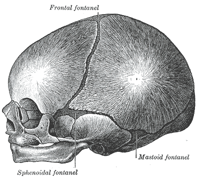

In [Part 1]() I started with a few questions about why we all look different, and with my own guess in three parts: genes, food and the mind. Genes turned out to be the biggest part: twin studies put the heritability of facial distances at about 0.5 to 0.8, and two siblings don't carry the same genes but a fresh shuffle of their parents' genomes. But identical twins, with almost the same genome, still look a little different and drift apart with age. So, in this part, the rest of my guess, food and the mind, and then the question I kept for last: why do all babies look alike?

## Food and atoms: where my guess was closer than I thought

My second guess was that food adds different kinds of atoms to our body, and that these different atoms make us look different. Let us check the first half of it: do different people really carry different kinds of atoms?

The International Commission on Radiological Protection keeps a "Reference Man", a 70 kg adult whose body has been taken apart element by element. Six elements make up 99.1% of his mass[^icrp]:



*Figure 14. What a 70 kg human body is made of, by mass. Data: ICRP Publication 23, "Reference Man", Table 110.[^icrp]*

These are the same six elements for me, for you, for a farmer in Punjab and for a software engineer in Bengaluru. Whatever we eat, rice or bread, dal or steak, it is made of the same oxygen, carbon, hydrogen and nitrogen, and our body takes them apart and rebuilds us out of them. So, as I wrote it, "different kinds of atoms" is wrong. The table goes on with iron, zinc, copper and 27 more elements, but together they add up to less than one percent, and nobody's face is shaped by the 4 g of iron in their body.[^icrp]

But there is a twist which I didn't know about, and it is the reason this section has the title it has.

### Same element, different weight

An element can come in slightly different weights, called *isotopes*. Most carbon atoms are carbon-12, and a small fraction are carbon-13, with one extra neutron. Plants take their carbon from the air, and different plants take in a slightly different share of carbon-13; corn has noticeably more of it than soybean.[^ehleringer2020] Chemists write the amount of carbon-13 as

$$
\delta^{13}\mathrm{C} = \left(\frac{R_\text{sample}}{R_\text{standard}} - 1\right) \times 1000,
$$

where $$R$$ is the ratio of carbon-13 to carbon-12, and the result is in parts per thousand (‰). The numbers are negative because almost everything has less carbon-13 than the reference: corn reads about $$-13$$‰ and soybean about $$-29$$‰.[^ehleringer2020]

Now, your hair is built from the protein you ate while it was growing, so it carries the ratio of your diet.[^ehleringer2020] Hope Jahren and Richard Kraft bought more than 480 burgers, chicken sandwiches and fries from McDonald's, Burger King and Wendy's in six American cities and measured them. Out of all the beef and chicken, only 12 beef servings had $$\delta^{13}\mathrm{C}$$ below $$-21$$‰, i.e. almost all of it came from animals fed mainly on corn.[^jahren]

In India, corn is a small part of what people eat, so the picture is different. Gunjan Agrawal and Prasanta Sanyal at IISER Kolkata, in West Bengal, collected the 66 food items that went into the meals of their campus kitchen (rice, wheat, dal, vegetables, fish, meat, milk products and sugar) and measured them.[^agrawal] Grains averaged $$-26.9$$‰ and vegetables $$-27.7$$‰, i.e. almost everything on the plate came from plants like rice and wheat, which take in less carbon-13 than corn. Dairy ($$-22.3$$‰) and poultry and meat ($$-23.4$$‰) were a little heavier, and the only item anywhere close to corn was sugar from sugarcane, at $$-12.7$$‰.[^agrawal]

A later study went one step further and measured the hair of people from 65 American communities. 96% of the values fell between $$-20$$ and $$-16$$‰, with an average of $$-17.3$$‰.[^ehleringer2020] They also worked out the two ends: hair of a person whose animal protein is entirely from corn-fed animals would read $$-11.4$$‰, and with no corn-fed animal protein at all $$-24.8$$‰.[^ehleringer2020] So, a simple mixing calculation gives the share of corn-fed protein in an average American's diet:

$$
f = \frac{-17.3 - (-24.8)}{-11.4 - (-24.8)} = \frac{7.5}{13.4} \approx 0.56,
$$

i.e. about 56%. The paper reports a town and city average of 57%, so my back-of-the-envelope number is close, and it found up to 75% for some people, with higher values in poorer neighbourhoods.[^ehleringer2020]

Indian hair is much lighter. The 99 people sampled on the IISER Kolkata campus had an average of $$-21.1$$‰[^agrawal], below the whole range which held 96% of the American hair. A wider survey collected hair from volunteers and barbershops in 13 Indian cities, from New Delhi and Jaipur to Chennai and Vellore, and found an Indian average of $$-19.8$$‰.[^thompson] So, Indian hair sits 2.5 to 4‰ below American hair, and that gap is the difference between a rice and wheat diet and a corn-fed meat diet. The few high values in India came from coastal Chennai and nearby Vellore, together with high nitrogen and sulphur values, which the authors read as people eating fish.[^thompson]



*Figure 15. Carbon-13 in human hair in the USA and India. Dots are averages; the American bar holds 96% of people, the Indian bars run from the lowest to the highest sample. Dashed lines are the two ends worked out for American hair: no corn-fed animal protein, and all of it corn-fed. Data: Ehleringer et al. 2020[^ehleringer2020], Thompson et al. 2010, Table 1[^thompson], Agrawal & Sanyal 2024, Table 2.[^agrawal]*

Carbon tells you about the plants at the bottom of the food chain. To see meat, there is a second isotope: nitrogen-15. Every step up the food chain adds a bit more of it, i.e. an animal's body is richer in nitrogen-15 than the plants it ate, and our hair is richer than our food. In the Kolkata kitchen, plant foods averaged $$\delta^{15}\mathrm{N} = 2.9$$‰ and animal foods $$5.9$$‰, and the residents' hair was 3.9‰ above their diet.[^agrawal] The dining hall had a computerised bill for every plate, so the authors knew what 74 of the residents had eaten for a week. The hair of the lacto-vegetarians had $$\delta^{15}\mathrm{N}$$ 0.9‰ lower than that of the omnivores, while their carbon values were almost the same; and for every 5% more of the protein coming from animals, both values went up by 0.4 to 0.5‰.[^agrawal] So, a strand of hair can roughly tell whether an Indian eats meat. Roughly, because milk, curd and paneer are animal protein too: the vegetarians got 16 to 31% of their protein from animals, so their values overlapped with the omnivores.[^agrawal]

That wider survey saw the same thing at the scale of countries. The average nitrogen value of Indian, Chinese and Pakistani hair was closer to the values published for vegetarians in the West than to Western meat eaters, and some Indian and Chinese samples were below even Western vegans, the lowest values for human hair the authors had seen published.[^thompson]

It doesn't stop at carbon. Hydrogen and oxygen also come in heavier isotopes, and the ratio in your hair follows the tap water you drink. In hair from 65 American cities, a model with only the local tap water plus a common "supermarket" diet explained more than 85% of the variation between cities.[^ehleringer2008]

Asia has a much wider spread of water than America, and the same thing shows up there. The same survey measured hair and tap water together in 23 towns and cities of China, India, Mongolia and Pakistan.[^thompson] The heaviest water and the heaviest hair both came from India, and the lightest from Mongolia. For hydrogen, written as $$\delta^{2}\mathrm{H}$$ in the same way as carbon, they found

$$
\delta^{2}\mathrm{H}_\text{hair} = 0.42\,\delta^{2}\mathrm{H}_\text{water} - 75,
$$

with both sides in ‰, and this line explained 75% of the variation between places.[^thompson] Consider Udaipur and New Delhi. Udaipur gets its water from lakes, where evaporation leaves the heavier water behind, and its tap water read $$+4$$‰; New Delhi's read $$-50$$‰.[^thompson] The line says the hair in the two cities should differ by

$$
0.42 \times \left(4 - (-50)\right) \approx 23\ \text{‰},
$$

and the measured hair was $$-75$$‰ in Udaipur and $$-98$$‰ in New Delhi, i.e. 23‰ apart.[^thompson] With only 5 hair samples from Udaipur and 3 from New Delhi, the perfect match is partly luck, but the direction is clear. The same model also says something about the food: to fit the Asian data, about 15% of the diet had to be grown locally, against 0% assumed for the American "supermarket" diet and 67% for people sampled before globalisation.[^thompson]

So, my guess was right in a way I didn't expect: what you eat and drink really does change the atoms in your body, enough that a lab can read your diet and your city off a strand of hair. But a carbon-13 atom in your cheek is still carbon, and the cheek has the same shape either way.

### Are we what we eat?

There is a popular claim that every atom in your body is replaced every seven years. If that were true, the food would be rebuilding our faces all the time. The real picture is more mixed. A Swedish team used a clever clock: the nuclear bomb tests of 1955-63 doubled the carbon-14 in the air, and a cell locks in the carbon-14 level of the year its DNA was made. Measured this way, the cells of the small intestine (taking the whole tissue) were on average 10.7 years old and those of a muscle between the ribs 15.1 years old, while the neurons of the visual cortex were as old as the person, within about two years.[^spalding] Overall, our body replaces about 80 g of cells every day, mostly blood cells and the lining of the gut[^sender], and about 10% of the skeleton is rebuilt each year.[^weilbaecher]

So, the atoms flow through us, some fast and some almost never, and the face keeps its shape anyway. The shape is held by the plan and not by any particular atoms, the same way a river keeps its course while the water in it changes.

### What food does change

If not the kind of atoms, what about the amount? Here the evidence is strong, and the clearest example is height. The NCD Risk Factor Collaboration put together 1,472 studies with more than 18.6 million people, and estimated the average adult height of people born in every year from 1896 to 1996 in 200 countries.[^ncdrisc] They state that differences between countries come mostly from non-genetic factors: growth in the womb, which depends on the mother's own size and nutrition, and nutrition and infections in childhood and adolescence.[^ncdrisc]



*Figure 16. Average adult height of women by year of birth. South Korean women gained the most of any group in the world. Data: NCD Risk Factor Collaboration 2016, [CC BY 4.0](https://creativecommons.org/licenses/by/4.0/).[^ncdrisc]*

South Korean women born in 1996 are 20.2 cm taller than those born in 1896, the largest gain anywhere; Iranian men gained 16.5 cm.[^ncdrisc] Indian women gained only 4.6 cm in the same century, and the authors write that height in South Asia has stalled at a much lower level than in East Asia.[^ncdrisc] The genes of Koreans did not change in a hundred years. What changed is how much and how well children ate, and how often they were sick.

Then there is chewing. A comparison of skulls from populations around the world found that the skull as a whole follows population history, i.e. genes, but the lower jaw follows what people ate: hunter-gatherers have longer and narrower lower jaws than farmers, even after accounting for history, geography and climate.[^cramon] The explanation offered is that softer farmed food means less chewing force on the growing jaw. A later study found the same direction but a modest size, with the genes and population history still dominating the overall shape of the skull.[^katz] And one experiment tested it directly on rock hyraxes: animals raised on cooked, soft food had about 10% less growth in the lower and back parts of the face than those raised on raw, hard food.[^lieberman]

The neatest test I found used identical twins, where the genes are fixed. One study photographed 186 pairs of identical twins and compared how old each twin looked. The twin who had smoked longer looked older, and the twin with the higher body mass index looked older before about 40 and younger after it.[^guyuron]

So, the verdict on my food guess: the "different kinds of atoms" part is wrong, the elements are the same in everyone. But food does leave a chemical fingerprint in us, and how much we eat as children, how hard we chew and how we live really do change the size and shape of a face. Two siblings at the same table eat roughly the same food, though, so food can't be the reason they look different from each other. What about the mind?

## The mind: do our thoughts show on our face?

My last guess was that our mental structure, i.e. our thoughts, might change how we look to others or how we see ourselves. Here are the claims people actually make, one by one.

### Do we grow into our names?

In 2017, a set of eight studies was published with a surprising claim: people can guess a stranger's first name from their face better than chance.[^zwebner] In their first study, 121 Israeli students saw 20 faces with five names each and picked the right name 28% of the time, against 20% by chance. French participants guessing French faces got 41% against 25%. A computer trained on about 94,000 photos picked the right name out of two 54 to 64% of the time, against 50%. The effect disappeared for faces from another culture, and showing only the hairstyle was enough to produce it.[^zwebner] Their explanation was a self-fulfilling prophecy: a name carries expectations, and over the years we grow to look the part, for example through how we style ourselves.

It is a lovely idea, but the effect is small. In 2026, a repeat study whose method was fixed before collecting data found that people picked the right name out of two 52% of the time against 50% by chance, which the authors call inconclusive.[^verheyen] So, I would not bet on it.

### Do couples grow to look alike?

This one is a classic. In 1987, a study took photos of 12 couples from their first year of marriage and from about 25 years later, and asked 110 students to match each face with its spouse among six faces. The newly-weds were not judged more alike than chance, but after 25 years they were, and the couples whose resemblance grew most also reported being happier.[^zajonc] The proposed reason: decades of mimicking each other's expressions slowly reshape the face.

Twelve couples is a very small sample. In 2020, a new study repeated it with 517 couples, photographed within two years of their wedding and again 20 to 69 years later.[^teamakorn]



*Figure 17. How alike strangers judged married couples, at marriage and decades later. Each judge ranked six faces by how much they resembled the spouse; 1 means the real spouse was always picked as most alike and 3.5 is chance. Data: Zajonc et al. 1987, Table I (resemblance)[^zajonc]; Tea-makorn & Kosinski 2020, human judges.[^teamakorn]*

The large study found that spouses do look alike, already at the wedding, but they don't converge: the judges rated them slightly less alike later, and a face recognition algorithm found no change at all.[^teamakorn] So, couples look alike because people pick partners who look like them, not because living together reshapes their faces.

### Expressions and wrinkles

Here the mind does leave a mark, but through muscles and not through thoughts directly. The lines between the eyebrows are made by the frown muscles folding the skin over and over. The best evidence is that switching those muscles off works: a Cochrane review of 65 trials with 14,919 people found that botulinum toxin injected into the frown muscles clearly improves these lines within four weeks compared with a placebo.[^cochrane] Not all wrinkles come from expressions, though; some come from the face being pressed into a pillow every night, and they sit in different places.[^anson] So, a person who frowns a lot for decades will probably carry it on their forehead. That is a real, if small, way in which our inner life shows on our face.

### How we see ourselves

The second half of my guess was about how we see ourselves, and here the mind plays a much bigger role. Think about it: the face you know best is the one in the mirror, i.e. flipped left to right, while everyone else sees the unflipped one. In a 1977 study, photos of women were printed both ways, and each woman and her partner were asked which print they liked better.[^mita]



*Figure 18. Which print of a woman's photo she and her partner liked better, the normal one or the mirror image. Modal choice over five trials, 28 couples. Data: Mita, Dermer & Knight 1977, Study 2.[^mita]*

20 of the 28 women preferred their mirror image, and 19 of their 28 partners preferred the true one.[^mita] Each of them liked the version they were used to seeing. This is the *mere exposure effect*, and it is why most of us feel a little uncomfortable with our own photos. So, our mind doesn't change our face, but it does change which face we think is ours.

### How others read us

And others read things into our faces which are not there. People agree with each other a lot when they judge someone's character from a photo, and these quick judgements even predict who wins elections, but their accuracy has been greatly overstated.[^todorov] In one test with over a million judgements, people guessing things about strangers from their photos did worse than if they had ignored the face and guessed from how common each answer was.[^olivola] So, our face is read by others all the time, and mostly misread.

So, the verdict on the third guess: our thoughts don't reshape our faces, apart from the lines our habitual expressions leave behind; the name effect is shaky and couples don't converge. But the mind has a large say in how we see our own face and in what others believe it says about us.

## Babies to adults: why do all babies look alike?

Now the question in the subtitle. To me, most newborns look alike, and then somewhere in childhood each of them turns into a face of their own. Why?

The first part of the answer is that every baby face follows the same recipe: a big head, a high forehead, big eyes, round cheeks, and a small nose and mouth. Konrad Lorenz called this set of features *Kindchenschema*, i.e. the baby schema, in 1943.[^lorenz] One study tested it by morphing photos of infants to have more or less of the schema, and 122 students rated the high-schema faces as cuter and said they felt more like taking care of them.[^glocker] So, babies share one set of proportions, and our brain reacts strongly to exactly that set.

The second part is where these proportions come from. Look at a newborn's skull from the side:

*Figure 19. The skull of a newborn, with the soft gaps (fontanelles) between the bones of the braincase. The face is a small part at the lower left. Drawing by Henry Vandyke Carter from Gray's Anatomy (1918), [public domain](https://commons.wikimedia.org/wiki/File:Gray198.png), via Wikimedia Commons.*

The braincase is huge and the face is tiny, because the brain grows first. The WHO growth standards put the median head circumference of a boy at 34.5 cm at birth, 46.1 cm at one year and 50.7 cm at five years; for girls it is 33.9, 44.9 and 49.9 cm.[^who] So, a boy's head grows by 11.6 cm in the first year and by only 4.6 cm in the next four.

The face takes much longer. In 1992, a team led by Leslie Farkas measured the heads and faces of about 1,600 children in Toronto, aged 1 to 18, with calipers and a tape, and published the averages for every age in five papers.[^farkashead][^farkasface][^farkasorbit][^farkasnose][^farkasear] So, a simple question: how much of its size at 18 does each part already have at age 1?



*Figure 20. Size at age 1 as a share of the size at 18, average of boys and girls. Blue: the head and the parts around the eyes; red: the rest of the face. "Lower face height" is the mouth to the chin, and "nose tip sticking out" is how far the tip of the nose stands out in front of the base of the nose. Data: Farkas et al. 1992, Table 2 of each paper.[^farkashead][^farkasface][^farkasorbit][^farkasnose][^farkasear]*

A one-year-old already has 87.5% of the head circumference of an 18-year-old, and the ear is 93.5% as wide. The distance between the eyes is about 85% there. But the face is only 67.8% as long, the nose 59% as long, and the tip of the nose sticks out only half as much as it will at 18. Over the years the gap closes:



*Figure 21. How four measurements grow from age 1 to 18, as a share of their size at 18, average of boys and girls. Different children were measured at each age, so the curves wobble a little, and a few ages come out slightly above their size at 18. Data: Farkas et al. 1992, Table 1 of the head, face and nose papers.[^farkashead][^farkasface][^farkasnose]*

The head is almost done by 5. The nose keeps growing through the teens: its tip is the last part of the face to reach adult size, at 16 in boys and 14 in girls, while the skin of the upper lip is the first, at 6 in boys and 3 in girls.[^farkasnose] Overall, the face matures at 12 to 15 years in boys and about two years earlier in girls.[^farkasface] And in boys it doesn't fully stop at 18: one study X-rayed 25 boys every year or so from 4 to 25, and most of their facial widths and heights were still growing at 18.[^snodell] Of the 11 men with X-rays after 20, 9 were still getting wider across the cheekbones, by 0.5 to 1.9 mm.[^snodell]

Now, put this together with what we saw before. The parts which make a face individual, i.e. the nose, the jaw, the length of the face, are exactly the parts which are least grown in a baby. A baby's face is mostly braincase, eyes and ears, which are already close to their adult size, while the parts which make you look like *you* are still waiting to grow. Try it here: drag the age and watch which parts move.



*Figure 22. Average faces by age. Each stop on the slider is the average of about 150 photos of people looking straight at the camera, for ages 0-2, 3-6, 7-9, 10-14, 15-19 and 20-29; in between, the two nearest averages are bent to an in-between shape and blended. The photos are lined up on the eyes and the mouth, so every face is shown at the same size and only the proportions change. Photos from the FFHQ dataset[^ffhq] with age labels from FFHQ-Aging[^ffhqaging]; the averages are [CC BY-NC-SA 4.0](https://creativecommons.org/licenses/by-nc-sa/4.0/), and every photo used is credited [here](/assets/data/what-makes-us-look-different/ffhq-credits.txt).*

### Puberty finishes the job

Most of the late growth comes with puberty, which normally starts between 8 and 12 in girls and between 9 and 14 in boys.[^abreu] This is also when boys' and girls' faces separate. One study scanned the faces of 30 Czech children in 3D every year from 12 to 15.[^koudelova] At 12 and 13, boys' and girls' faces were not different; from 14 they were, and mostly in size. The boys got more prominent brow ridges, deeper-set eyes, flatter cheeks, and a bigger nose and chin.[^koudelova] In a larger study, 60 women judged the sex of 520 teenage faces rebuilt from MRI scans: 12-year-old faces were judged at chance, and the boys with more testosterone in their blood were more often correctly called male.[^mareckova]

But the plan is set even earlier. An Australian study measured testosterone in the umbilical cord blood of 183 newborns, and scanned the same people's faces 21 to 24 years later. More testosterone at birth went with a more masculine adult face, while adult testosterone in the men showed no link at all ($$r = 0.01$$).[^whitehouse] So, the hormones before birth draw part of the plan, and puberty builds it.

### Are babies alike, or are we bad at babies?

There is one more piece, and it is about us. People recognise faces of their own age group better than others, the same way we saw in Part 1 for faces of our own race. A study which pooled 27 earlier studies, with 2,879 people in all, found this own-age bias to be a small to moderate effect for telling faces apart.[^rhodes] Young adults with little experience of babies remember adult faces better than infant faces, and they look less at the eyes of an infant face.[^proietti] And experience fixes it: in studies reviewed in the same paper, maternity ward nurses with about 16 years on the job showed a smaller own-age bias for newborn faces than other people.[^rhodes]

Mothers are the best example. Within 33 hours of birth, mothers could pick their own baby's photo out of photos of other newborns[^porter], and mothers who already had a baby before did this better than first-time mothers.[^kaitz] So, a newborn's face does carry an identity; most of us are just not trained to read it.

So, are babies alike, or are we bad at babies? Both, I think. A baby's face really has less of the individual parts, as the Farkas data shows, and adults really are experts in adult faces.

## Try it yourself

A few things you can do at home with what we saw:

1. Take a selfie and flip it in your phone's photo editor. Show both to a friend and ask which one looks more like you, then decide for yourself. If you behave like the people in that 1977 study, you will pick different ones (Figure 18).
2. Take out an old family album and try to match the baby photos of your cousins or siblings to their adult photos, and then ask your mother to do the same. My guess, from the studies above, is that she will beat you.
3. Make two children from the same parents in the sibling shuffler ([Figure 10 in Part 1]()) a few times, and see how far apart they can land.
4. Move the sliders of the face mixer ([Figure 12 in Part 1]()) one at a time and notice how little change is needed before the face looks like a different person.

## So, what makes us look different?

Let me go back to my guess and score it.

1. Genes: yes, and they are the biggest part. Twin studies put the heritability of facial distances at about 0.5 to 0.8. But my doubt about siblings was based on a wrong assumption: siblings don't carry the same genes. Each child is a fresh shuffle of the parents' genomes, and two siblings share 49.8% of it on average, anywhere from about 37% to 62%.
2. Food: the "different atoms" part was wrong. Every one of us is made of the same elements in nearly the same proportions. But the food does leave a record, in the heavier and lighter isotopes of carbon, nitrogen and hydrogen in our hair, and how much we eat changes how tall we grow, and what we chew changes the jaw a little.
3. The mind: it doesn't reshape the face, apart from the lines our expressions fold into the skin over decades. But it decides a lot about how we see our own face and what others think it says about us.

There was a part I didn't guess at all: chance. Even identical twins, with the same genome, the same womb and the same food, start with a few different mutations, and the chemical tags on their DNA, which switch genes on and off, change with age. A face is assembled from five pieces in the first two months, layer by layer, and growing it takes 18 years; small random differences in all those steps add up. Our faces are not just a printout of a recipe.

And the two premises from the start. Other animals don't really look the same: sheep, monkeys and wasps tell each other apart, and we can't because our brain is tuned to human faces. But human faces do vary more than the rest of our body, in a way which looks like evolution favoured being recognisable. As for babies, they look alike to us partly because the individual parts of their faces haven't grown yet, and partly because we are not trained on baby faces.

I find it nice that the question of why we look different ends with the people looking at us. A face is something to be recognised, by our mothers, our friends, even by ourselves in the mirror, and in that sense how we look is never only about us. What do you think?

Until next time.

---

## References

[^icrp]: ICRP, *Report of the Task Group on Reference Man*, ICRP Publication 23, Pergamon Press, 1975, Table 110, pp. 327-328. [doi](https://doi.org/10.1016/S0074-2740(75)80023-7). Scan of the table via [BioNumbers](https://bionumbers.hms.harvard.edu/bionumber.aspx?id=110328).

[^jahren]: Jahren & Kraft, "Carbon and nitrogen stable isotopes in fast food: signatures of corn and confinement", PNAS, 2008. [doi](https://doi.org/10.1073/pnas.0809870105)

[^ehleringer2020]: Ehleringer, Covarrubias Avalos, Tipple, Valenzuela & Cerling, "Stable isotopes in hair reveal dietary protein sources with links to socioeconomic status and health", PNAS, 2020. [doi](https://doi.org/10.1073/pnas.1914087117)

[^ehleringer2008]: Ehleringer et al., "Hydrogen and oxygen isotope ratios in human hair are related to geography", PNAS, 2008. [doi](https://doi.org/10.1073/pnas.0712228105)

[^agrawal]: Agrawal & Sanyal, "Discerning animal-sourced food in diet using isotope analysis of human scalp hair and fingernails", European Journal of Nutrition, 2024. [doi](https://doi.org/10.1007/s00394-023-03273-y)

[^thompson]: Thompson, Chesson, Podlesak, Bowen, Cerling & Ehleringer, "Stable isotope analysis of modern human hair collected from Asia (China, India, Mongolia, and Pakistan)", American Journal of Physical Anthropology, 2010. [doi](https://doi.org/10.1002/ajpa.21162)

[^spalding]: Spalding, Bhardwaj, Buchholz, Druid & Frisén, "Retrospective birth dating of cells in humans", Cell, 2005, p. 135 and Fig. 3. [doi](https://doi.org/10.1016/j.cell.2005.04.028)

[^sender]: Sender & Milo, "The distribution of cellular turnover in the human body", Nature Medicine, 2021. [doi](https://doi.org/10.1038/s41591-020-01182-9)

[^weilbaecher]: Weilbaecher, Guise & McCauley, "Cancer to bone: a fatal attraction", Nature Reviews Cancer, 2011, Figure 1 legend (a review, i.e. a secondary source for this number). [doi](https://doi.org/10.1038/nrc3055)

[^ncdrisc]: NCD Risk Factor Collaboration, "A century of trends in adult human height", eLife, 2016, CC BY 4.0. [doi](https://doi.org/10.7554/eLife.13410)

[^cramon]: N. von Cramon-Taubadel, "Global human mandibular variation reflects differences in agricultural and hunter-gatherer subsistence strategies", PNAS, 2011. [doi](https://doi.org/10.1073/pnas.1113050108)

[^katz]: Katz, Grote & Weaver, "Changes in human skull morphology across the agricultural transition are consistent with softer diets in preindustrial farming groups", PNAS, 2017. [doi](https://doi.org/10.1073/pnas.1702586114)

[^lieberman]: Lieberman, Krovitz, Yates, Devlin & St Claire, "Effects of food processing on masticatory strain and craniofacial growth in a retrognathic face", Journal of Human Evolution, 2004. [doi](https://doi.org/10.1016/j.jhevol.2004.03.005)

[^guyuron]: Guyuron et al., "Factors contributing to the facial aging of identical twins", Plastic and Reconstructive Surgery, 2009. [doi](https://doi.org/10.1097/PRS.0b013e31819c4d42)

[^zwebner]: Zwebner, Sellier, Rosenfeld, Goldenberg & Mayo, "We look like our names: the manifestation of name stereotypes in facial appearance", Journal of Personality and Social Psychology, 2017, Studies 1A, 2, 4 and 6. [doi](https://doi.org/10.1037/pspa0000076)

[^verheyen]: Verheyen, Van den Berckt & Heyman, "Do we look like our siblings' names? A socio-onomastic perspective on the face-name matching effect", International Review of Social Psychology, 2026, CC BY 4.0. [doi](https://doi.org/10.5334/irsp.1243)

[^zajonc]: Zajonc, Adelmann, Murphy & Niedenthal, "Convergence in the physical appearance of spouses", Motivation and Emotion, 1987, pp. 337-345. [doi](https://doi.org/10.1007/BF00992848)

[^teamakorn]: Tea-makorn & Kosinski, "Spouses' faces are similar but do not become more similar with time", Scientific Reports, 2020, CC BY 4.0. [doi](https://doi.org/10.1038/s41598-020-73971-8)

[^cochrane]: Camargo et al., "Botulinum toxin type A for facial wrinkles", Cochrane Database of Systematic Reviews, 2021. [doi](https://doi.org/10.1002/14651858.CD011301.pub2)

[^anson]: Anson, Kane & Lambros, "Sleep wrinkles: facial aging and facial distortion during sleep", Aesthetic Surgery Journal, 2016. [doi](https://doi.org/10.1093/asj/sjw074)

[^mita]: Mita, Dermer & Knight, "Reversed facial images and the mere-exposure hypothesis", Journal of Personality and Social Psychology, 1977, Study 2, pp. 598-600. [doi](https://doi.org/10.1037/0022-3514.35.8.597)

[^todorov]: Todorov, Olivola, Dotsch & Mende-Siedlecki, "Social attributions from faces: determinants, consequences, accuracy, and functional significance", Annual Review of Psychology, 2015. [doi](https://doi.org/10.1146/annurev-psych-113011-143831)

[^olivola]: Olivola & Todorov, "Fooled by first impressions? Reexamining the diagnostic value of appearance-based inferences", Journal of Experimental Social Psychology, 2010. [doi](https://doi.org/10.1016/j.jesp.2009.12.002)

[^lorenz]: K. Lorenz, "Die angeborenen Formen möglicher Erfahrung", Zeitschrift für Tierpsychologie, 1943 (in German; cited for the idea of the baby schema). [doi](https://doi.org/10.1111/j.1439-0310.1943.tb00655.x)

[^glocker]: Glocker, Langleben, Ruparel, Loughead, Gur & Sachser, "Baby schema in infant faces induces cuteness perception and motivation for caretaking in adults", Ethology, 2009. [doi](https://doi.org/10.1111/j.1439-0310.2008.01603.x)

[^who]: World Health Organization, Child Growth Standards, head circumference-for-age, 0 to 5 years, z-score tables for boys and girls (median values). [link](https://www.who.int/tools/child-growth-standards/standards/head-circumference-for-age)

[^farkashead]: Farkas, Posnick & Hreczko, "Anthropometric growth study of the head", Cleft Palate-Craniofacial Journal, 1992, pp. 303-308. [doi](https://doi.org/10.1597/1545-1569_1992_029_0303_agsoth_2.3.co_2)

[^farkasface]: Farkas, Posnick & Hreczko, "Growth patterns of the face: a morphometric study", Cleft Palate-Craniofacial Journal, 1992, pp. 308-315. [doi](https://doi.org/10.1597/1545-1569_1992_029_0308_gpotfa_2.3.co_2)

[^farkasorbit]: Farkas, Posnick, Hreczko & Pron, "Growth patterns in the orbital region: a morphometric study", Cleft Palate-Craniofacial Journal, 1992, pp. 315-318. [doi](https://doi.org/10.1597/1545-1569_1992_029_0315_gpitor_2.3.co_2)

[^farkasnose]: Farkas, Posnick, Hreczko & Pron, "Growth patterns of the nasolabial region: a morphometric study", Cleft Palate-Craniofacial Journal, 1992, pp. 318-324. [doi](https://doi.org/10.1597/1545-1569_1992_029_0318_gpotnr_2.3.co_2)

[^farkasear]: Farkas, Posnick & Hreczko, "Anthropometric growth study of the ear", Cleft Palate-Craniofacial Journal, 1992, pp. 324-329. [doi](https://doi.org/10.1597/1545-1569_1992_029_0324_agsote_2.3.co_2)

[^snodell]: Snodell, Nanda & Currier, "A longitudinal cephalometric study of transverse and vertical craniofacial growth", American Journal of Orthodontics and Dentofacial Orthopedics, 1993, Table III p. 475 and p. 481. [doi](https://doi.org/10.1016/0889-5406(93)70073-W)

[^abreu]: Abreu & Kaiser, "Pubertal development and regulation", Lancet Diabetes & Endocrinology, 2016. [doi](https://doi.org/10.1016/S2213-8587(15)00418-0)

[^koudelova]: Koudelová, Brůžek, Cagáňová, Krajíček & Velemínská, "Development of facial sexual dimorphism in children aged between 12 and 15 years: a three-dimensional longitudinal study", Orthodontics & Craniofacial Research, 2015. [doi](https://doi.org/10.1111/ocr.12096)

[^mareckova]: Marečková et al., "Testosterone-mediated sex differences in the face shape during adolescence: subjective impressions and objective features", Hormones and Behavior, 2011. [doi](https://doi.org/10.1016/j.yhbeh.2011.09.004)

[^whitehouse]: Whitehouse et al., "Prenatal testosterone exposure is related to sexually dimorphic facial morphology in adulthood", Proceedings of the Royal Society B, 2015. [doi](https://doi.org/10.1098/rspb.2015.1351)

[^rhodes]: Rhodes & Anastasi, "The own-age bias in face recognition: a meta-analytic and theoretical review", Psychological Bulletin, 2012, pp. 150, 161 and 167. [doi](https://doi.org/10.1037/a0025750)

[^proietti]: Proietti, Macchi Cassia, dell'Amore, Conte & Bricolo, "Visual scanning behavior is related to recognition performance for own- and other-age faces", Frontiers in Psychology, 2015. [doi](https://doi.org/10.3389/fpsyg.2015.01684)

[^porter]: Porter, Cernoch & Balogh, "Recognition of neonates by facial-visual characteristics", Pediatrics, 1984, 74(4):501-504. [PubMed](https://pubmed.ncbi.nlm.nih.gov/6483516/)

[^kaitz]: Kaitz, Rokem & Eidelman, "Infants' face-recognition by primiparous and multiparous women", Perceptual and Motor Skills, 1988. [doi](https://doi.org/10.2466/pms.1988.67.2.495)

[^ffhq]: Karras, Laine & Aila, "A Style-Based Generator Architecture for Generative Adversarial Networks", CVPR, 2019: the FFHQ dataset of 70,000 aligned face photos from Flickr, each under CC BY 2.0, CC BY-NC 2.0, PDM 1.0, CC0 1.0 or US Government Works. [doi](https://doi.org/10.1109/CVPR.2019.00453), [dataset](https://github.com/NVlabs/ffhq-dataset)

[^ffhqaging]: Or-El, Sengupta, Fried, Shechtman & Kemelmacher-Shlizerman, "Lifespan Age Transformation Synthesis", ECCV, 2020: age-group labels for FFHQ, CC BY-NC-SA 4.0. [doi](https://doi.org/10.1007/978-3-030-58539-6_44), [dataset](https://github.com/royorel/FFHQ-Aging-Dataset)
