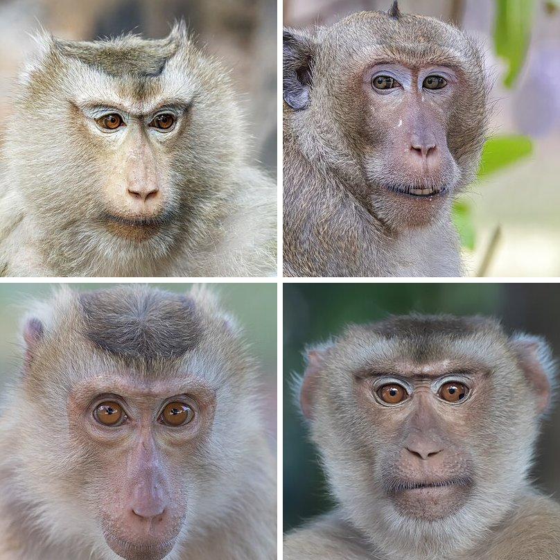
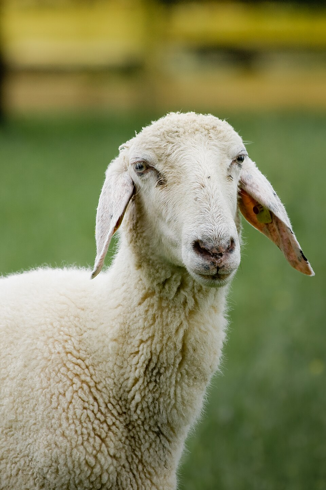
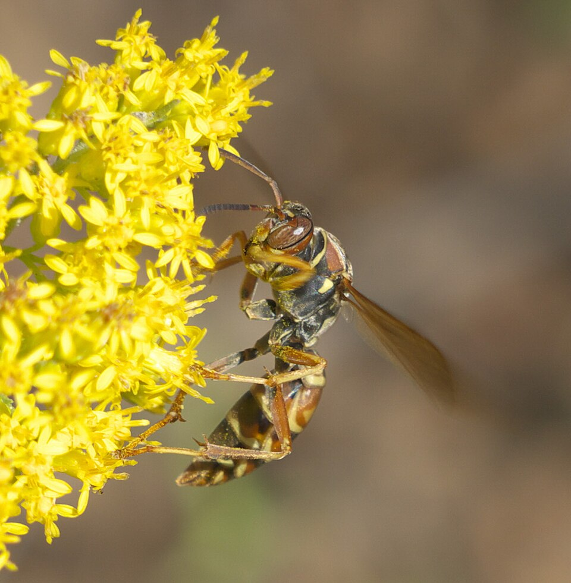
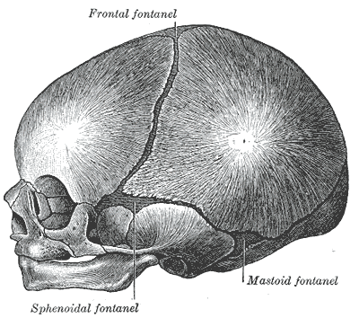
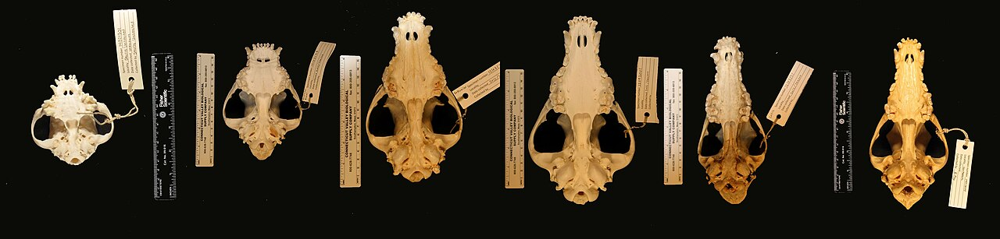

There are a few questions I have been pondering upon for some time:

1. Why do all humans look different?
2. Other animals look almost the same. Do they really?
3. What creates the look of a human face?
4. Why do most babies look alike, and how do we start looking unique as we grow?
5. Do DNA and genes have any role to play in this? If yes, how?

I also have my own guess. We inherit genes from our parents, and on top of that each of us eats different kinds of food, which is basically adding different kinds of atoms into our internal atomic environment, and that gives rise to different physical characteristics. But I doubt my own hypothesis: two people born in the same family, carrying the same genes, eating exactly the same food and living in the same physical environment still end up with different faces. So, is there something else? Does it have anything to do with our mental structure, i.e. do our thoughts change how we look to others, or how we see ourselves?

So, my guess has three parts: genes, food and the mind. Let us test each of them against data. As with [the apple post](), some parts of my guess turned out to be wrong and one part turned out to be closer than I thought. But first, the premise of the second question, which is not as obvious as it sounds.

## Do animals really look alike?

When I look at a herd of sheep, every sheep looks the same to me. When I look at a crowd of people, every face looks different. The easy conclusion is that sheep really are copies of each other and humans are not. But there is a second possibility: maybe the difference sits in my head, i.e. my brain is tuned to tell human faces apart and nothing else.

It turns out that our brain does have special hardware for faces. In a 1997 study, people lay in an fMRI scanner and looked at faces and ordinary objects. A small patch on the underside of the brain lit up more for faces than for objects in 12 of the 15 people scanned.[^kanwisher] It also responded more to intact faces than to scrambled ones, and more to faces than to houses or hands. The researchers called it the *fusiform face area*.

And this hardware gets a lot of practice. How many faces do you think you know? One study asked 25 people to write down every face they could recall, first people they know personally and then famous people, for an hour each, and then tested how many famous faces they could recognise from photos. The average came out to 4,240 faces, with the lowest at about 1,000 and the highest at about 8,600.[^jenkins] For comparison, the social groups humans lived in for most of our history were of the order of a hundred people.[^jenkins] So, we are carrying a face memory far bigger than what our ancestors ever needed.

Now, here is the part which surprised me. This skill is not fixed at birth; it narrows. A team led by Olivier Pascalis showed babies a face for a while and then put it next to a new face. Babies look longer at what is new, so if a baby looks longer at the new face, it has told the two apart. Six-month-olds did this for both human faces and monkey faces. Nine-month-olds and adults did it only for human faces; for monkey faces they looked at both equally, i.e. to them all the monkeys looked the same.[^pascalis] So, at six months we could tell monkeys apart, and by nine months we had lost it, because nobody around us was a monkey.



*Figure 1. How long babies and adults looked at a new face, as a share of the time spent on the new face plus the old one. At 50% they look at both equally, i.e. they can't tell the two apart. Six-month-olds told apart both human and monkey faces; by nine months the monkey faces were lost. In each test the old and the new face were shown side by side, for 10 seconds to babies and 5 seconds to adults. Computed from the mean looking times in Pascalis et al. 2002.[^pascalis]*

Try it on yourself. Here are four adult macaques, each photographed looking at the camera:

*Figure 2. Four macaques. Their photographers identify them as long-tailed macaques, <em>Macaca fascicularis</em>, the species Pascalis used. Look at them for a few seconds, look away, and then try to describe the one at the top right without looking back. Photos (cropped): top row [Charles J. Sharp](https://commons.wikimedia.org/wiki/File:Long-tailed_macaque_(Macaca_fascicularis)_female_head_Angkor.jpg) ([2](https://commons.wikimedia.org/wiki/File:Long-tailed_macaque_(Macaca_fascicularis)_male_head_Angkor.jpg)); bottom row [Basile Morin](https://commons.wikimedia.org/wiki/File:Macaca_fascicularis_looking_at_the_observer.jpg) ([2](https://commons.wikimedia.org/wiki/File:Macaca_fascicularis_looking_at_the_observer_front_view_at_bust_length.jpg)); all [CC BY-SA 4.0](https://creativecommons.org/licenses/by-sa/4.0), Wikimedia Commons. This montage is CC BY-SA 4.0 as well.*

If you are like me, they blur into "a monkey". A six-month-old you would have seen four different faces. Whether the monkeys see each other as different, we will ask them a little later.

The same thing happens between groups of humans. A study which pooled 91 earlier samples, with 4,996 participants in all, found that people are 1.4 times more likely to correctly recognise a face of their own race they have seen before, and 1.56 times more likely to falsely "recognise" a face of another race they have never seen.[^meissner] This is the *other-race effect*: the faces we grew up with are the ones we see in detail, and the rest look more alike than they are.

So, do animals really look alike, or is it only our eyes which can't see the difference? Let us ask the animals themselves, starting with the one which looks most alike to me: the sheep.

*Figure 3. A domestic sheep. To me it looks like every other sheep; to another sheep it does not. Photo: [Richard Bartz](https://commons.wikimedia.org/wiki/File:01_Ovis_orientalis_aries_portrait.jpg), [CC BY-SA 2.5](https://creativecommons.org/licenses/by-sa/2.5), Wikimedia Commons.*

In one experiment, 20 sheep were trained in a maze to pick one face out of each of 25 pairs of sheep faces, i.e. 50 faces in total, with food as the reward. The sheep then went back to the field. When they were tested again after up to 800 days, more than two years, they still picked the right faces well above chance, at about 71 to 83% depending on the delay.[^kendrick] Neurons in the sides and front of the sheep's brain still responded to the familiar faces after months apart.[^kendrick] So, sheep remember faces of other sheep for years, the same sheep which all look identical to me.

Now back to the monkeys of Figure 2. Our closest relatives tell each other apart too: chimpanzees and rhesus monkeys can match two different photos of the same individual of their own species, and they rely mostly on the eyes.[^parr] And the narrowing we saw in babies works both ways: capuchin monkeys and macaques are better with faces of their own species than with ours, just like we are better with ours.[^dufour] In other words, to a monkey, we probably all look alike.

The most surprising example for me is a wasp. The paper wasp *Polistes fuscatus* lives in small colonies with a pecking order, and its face has yellow and brown markings which differ a lot from one wasp to another. When a biologist painted over the markings of some wasps, their nestmates became more aggressive towards them, as if a stranger had walked in, until they got used to the new face.[^tibbetts] In a later study, these wasps were trained in a small maze to pick one of two images. They learned wasp faces better than other patterns, at about 74% correct versus about 65%.[^sheehantibbetts] A close relative, *Polistes metricus*, which does not recognise individuals, did no better than chance on faces of its own species, about 49%, even though it could learn the other patterns.[^sheehantibbetts] So, a wasp's brain which is a tiny fraction of ours learned faces when it needed to, and its cousin which didn't need to never did.

*Figure 4. A northern paper wasp, <em>Polistes fuscatus</em>. The yellow and brown patches on its face differ from one wasp to the next, and its nestmates use them to know who is who. Photo: [xpda](https://commons.wikimedia.org/wiki/File:Polistes_fuscatus_P1350643a.jpg), [CC BY-SA 4.0](https://creativecommons.org/licenses/by-sa/4.0), Wikimedia Commons.*

So, the first part of the answer is about us and not about the animals: most animals look alike *to us* because our face system was trained on human faces, and the animals which need to know each other do it just fine. But this doesn't settle the question. It could still be that human faces really are more variable than the faces of sheep, monkeys or most other animals, and that our face system is tuned to a signal which is really there. That is what the next section is about.

## Human faces really are more variable

In 2014, two biologists, one of them from the wasp study above, asked a simple question: if faces exist to tell individuals apart, they should be more variable than the rest of the body, and the different parts of a face should vary independently of each other.[^sheehan] Take a password, for example. A long password made of random characters is hard to guess, but if each character is decided by the previous one, it is really one choice repeated and easy to guess. A face which works as an ID card is the same: its features should not all move together.

To test it they took the measurements of 2,010 US Army personnel, 18 distances on the face (nose length, nose breadth, eye spacing, ear length, and so on) and 46 on the rest of the body (hand length, arm length, stature, and so on).[^sheehan] For each distance they computed the *coefficient of variation*, i.e. the standard deviation divided by the mean, so that a 5 mm spread in a nose and a 5 mm spread in a leg are not compared as if they were the same thing. They found two things[^sheehan]:

1. Facial distances have a higher coefficient of variation than body distances, in all four groups they looked at (African American and European American, men and women).
2. Facial distances are much less correlated with each other. In the body, 95 to 99.8% of pairs of distances were significantly correlated; in the face only 47 to 84% were. Hand breadth and hand length go together ($$r^2 = 0.30$$), i.e. a long hand is usually a broad hand; but nose breadth and nose length barely go together at all ($$r^2 = 0.002$$).

The women's data of the US Army survey they used, from 1988, is public.[^ansur] It has 7 of their 18 facial distances and 44 of their body distances. On these 2,205 women the pattern holds: the average coefficient of variation is 7.2% for the face and 5.6% for the body.



*Figure 5. How much each measurement varies from woman to woman. Each dot is one distance; the vertical line is the average of its row. Data: 1988 US Army anthropometric survey, 2,205 women.[^ansur]*

The ear protrusion dot sitting at 14% is partly a measurement issue: it is a small distance (about 2 cm), so a millimetre of error is already a few percent. Even without it, the face average is 6.1%, still above the body. But the second result is the stronger one. The average $$r^2$$ between two body distances is 0.37, and between two facial distances only 0.06. In this data, hand breadth and hand length have $$r^2 = 0.35$$, close to their 0.30, while ear breadth and ear length have only 0.15.



*Figure 6. Left: a longer hand is almost always a broader hand. Right: a longer ear says much less about how broad it is. 600 women picked at random from the same data as Figure 5. Ears were measured to the nearest millimetre, so their dots sit on a grid.*

So, our faces are not just "more different" in size; they are made of parts which vary on their own, and that is exactly what you need if the face is supposed to carry an identity. They also found signs in the DNA that the genes linked to facial shape have been kept more diverse than neutral parts of the genome, which fits the same idea.[^sheehan]

Now, how much information does a face need to carry? There are about 8.2 billion people on Earth.[^un] If you want to give each of them a unique label made of yes/no answers, you need

$$
\log_2\left(8.2 \times 10^{9}\right) \approx 32.9 \text{ bits},
$$

i.e. 33 yes/no questions. Now suppose that for each facial feature you can only tell three levels apart, say small, medium and large. One such feature carries $$\log_2 3 \approx 1.58$$ bits, so you need

$$
\frac{32.9}{1.58} \approx 21
$$

features, *provided they are independent*. If knowing the nose length already tells you the nose breadth, the second feature adds almost nothing, just like the password where each character is decided by the previous one. So, the low correlations in Figure 6 are not a side detail; they are what makes a face usable as an ID at all. Of course, two people can share a label and still be told apart by their voice, their walk or the context, so this is the information needed to label everyone by face alone. Try it below.



So, now we know that the premise was half right. Animals look alike to us mostly because of our brains, but human faces really are unusually variable, and in a way that suits recognising individuals. The next question is the obvious one: where does all this variation come from? To answer it we first need to know how a face is built.

## What builds a face

A face starts very early, and it starts in pieces. About four weeks after fertilisation, the embryo has a dent where the mouth will be. Around it sit five bumps: one on top, which becomes the forehead and the nose, two on the sides, which become the upper jaw and the cheeks, and two below, which become the lower jaw.[^statpearlsface][^guarino]



*Figure 7. Left: the head of a human embryo about 29 days old, seen from below, with the five bumps around the future mouth (the stomodeum): the top one (frontonasal), the two side ones (maxillary) and the two lower ones (mandibular). Middle: about eight weeks, when the nose and mouth are formed. Right: which parts of the adult face come from which piece. Drawings by Henry Vandyke Carter from Gray's Anatomy (1918), public domain, via Wikimedia Commons ([1](https://commons.wikimedia.org/wiki/File:Gray44.png), [2](https://commons.wikimedia.org/wiki/File:Gray47.png), [3](https://commons.wikimedia.org/wiki/File:Gray48.png)).*

Over the next few weeks these five pieces grow towards each other and fuse. In week 5 the top bump splits into smaller bumps around two pits which become the nostrils. The upper lip closes by the end of week 6, when the side bumps meet the inner bumps of the nose. The roof of the mouth comes last: two shelves rise above the tongue around week 7, touch in the middle at week 8, and the seam between them disappears between weeks 9 and 12.[^guarino] The embryo is now a little over two months old and it has a face.

What happens when the pieces don't meet? You get a *cleft lip and palate*, i.e. a gap in the lip, the roof of the mouth or both. It happens in about 1 in 700 newborns worldwide.[^guarino] I find this a very clear way to see that a face is assembled: a cleft lip sits exactly where two of the bumps were supposed to fuse.

The other thing which surprised me is where the material comes from. Most of the tissue in these bumps comes from *neural crest cells*, cells which start near the developing brain and migrate into the face; the top bump is made entirely of them.[^guarino]

So, by week 12 the plan is in place. What gets built on it? Going from the inside out:

1. Bone: the skeleton of the face has 15 bones in Moore's count: the jaws, the cheekbones, the nose bones and a few small ones inside.[^moore] Some textbooks leave out one of the small ones and say 14. The lower jaw is the only one which moves.[^moore]
2. Muscle: the muscles of facial expression sit in the layer just under the skin, and most of them pull on the skin rather than on a joint.[^moore] That is why they can make a smile or a frown. Moore's table lists 17 of them (some grouped), all supplied by one nerve, the facial nerve.[^moore] There is no single agreed count, so "about twenty" is the right way to say it.
3. Fat: the fat under the skin of the face is not one blanket. Two plastic surgeons injected dye into 30 half-faces of cadavers and found separate compartments with walls in between: three in the cheek, three in the forehead, three around the eye, one along the nasolabial fold and one at the jowl.[^rohrich] These compartments age separately, which is one reason a face doesn't age as one mass.[^rohrich]
4. Skin: on top of everything, moving with the muscles under it.



*Figure 8. The layers of a face as plates on a rack, from bone at the back to skin at the front. Hover or tap any part: the bones are named after Moore's count, the muscles come with the action Moore's Table 8.3 gives for each[^moore], and the fat pads follow the compartments of Rohrich and Pessa.[^rohrich]*

So, a face is a stack of layers built on a plan made of five fused pieces. Every one of them can vary: a slightly wider side bump, a slightly longer nasal bone, a fat compartment which is a bit fuller. And the plan is drawn, to a large extent, by our genes. Let us see how.

## Genes: the shuffle

We have 23 pairs of chromosomes, one copy of each pair from the mother and one from the father. When the body makes an egg or a sperm, each one gets only one copy of every pair. If the choice was just "the mother's copy or the father's copy" for each of the 23 pairs, an egg could be made in

$$
2^{23} = 8{,}388{,}608
$$

ways, and a child, from one egg and one sperm, in $$2^{46} \approx 7.0 \times 10^{13}$$ ways. That is already about 8,500 times the number of people alive today. But it gets much bigger, because the copies are not passed on whole. Before they separate, the two copies of each chromosome swap pieces with each other; this is called *crossing over*. A large study of 23andMe families, with about 18,600 eggs and sperm, counted on average 41.6 crossovers per egg and 26.6 per sperm on the 22 non-sex chromosomes.[^campbell] Another set of genetic maps gives the same picture: the total map is 4,087 centimorgans long in women and 2,606 in men[^bherer], and since one crossover per 100 centimorgans is what a centimorgan means, that is about 41 crossovers per egg and 26 per sperm. Each crossover can fall at almost any point along the chromosome, so the number of possible eggs is no longer something you can write down as a count. In practice, no two eggs or sperm are alike.



*Figure 9. Making one egg or sperm, for one chromosome. A parent carries two copies of chromosome 1: the orange one came from their mother and the teal one from their father. The new copy is printed from one of them and switches to the other at every crossover pin, so it comes out as a patchwork. The dial shows the share of the new copy from the grandmother (0% on the left, 100% on the right), and the trays in front keep the last three copies. Chromosome 1 is 249 million letters long[^ncbi]; its genetic map gives on average 3.3 crossovers in an egg and 2.0 in a sperm.[^bherer] The crossovers are placed at random; the bands on the rods are only decoration.*

Now, this answers the doubt I raised at the start. I said two people born in the same family carry the same genes. They don't. Each child gets a different shuffle of the same parents. On average two siblings share 50% of their genome, but the average hides the spread. A team led by Peter Visscher measured it in 4,401 pairs of real siblings: the mean was 49.8% with a standard deviation of 3.6%, and the pairs ranged from 37.4% to 61.7%.[^visscher] So, one pair of brothers can share almost two-thirds of their genome and another pair less than two-fifths. My "same genes" assumption was wrong.

Here is the shuffle as a small simulation. It takes the real lengths of the 22 chromosomes[^ncbi] and the real number of crossovers for mothers and fathers[^bherer], makes two eggs and two sperm, and checks which stretches the two children got from the same grandparent. Press the second button a few times and watch the histogram build up.



*Figure 10. Two simulated children of the same parents. The dashed lines mark the mean and one standard deviation either side for 4,401 real sibling pairs.[^visscher]*

My simulation gives a mean of 50% and a standard deviation of about 4.1%, a bit wider than the real 3.6%. My guess for the gap is that the simulation lets crossovers fall anywhere independently of each other, while in real cells a crossover makes another one close to it less likely; this is called *crossover interference*.[^campbell] Evenly spaced crossovers shuffle the genome more evenly, so real siblings should vary a little less than my simulated ones. Either way, the point stands: siblings are not genetic copies.

### What about identical twins?

Identical twins come from one fertilised egg which split into two, so they really do start with the same genome. But even they are not exact copies. When the DNA of 381 pairs of identical twins in Iceland was sequenced, it turned out that the twins differ on average by 5.2 mutations which happened very early in development, and about 15% of the pairs differ by many more.[^jonsson] Then there are the chemical tags on the DNA, which switch genes on and off. A Spanish study compared 40 pairs of identical twins aged 3 to 74. In 35% of the pairs these tags were clearly different, and the differences were larger in older twins and in twins who had spent more of their lives apart; 50-year-old twins had about four times as many genes expressed differently as 3-year-old twins.[^fraga] So, identical twins start almost identical and drift apart as they live.

### How much of a face is in the genes?

Twins give us a neat way to measure this. Identical twins share all their genes and non-identical twins share about half, and both kinds usually grow up together. So, if a trait is more alike in identical twins than in non-identical ones, the difference must come from the genes. Falconer's formula turns this into a number, the *heritability*[^xiong]:

$$
h^2 = 2\left(r_{MZ} - r_{DZ}\right),
$$

where $$r_{MZ}$$ and $$r_{DZ}$$ are the correlations of the trait between identical (monozygotic) and non-identical (dizygotic) twins. Consider a made-up example: if nose width correlates at $$r_{MZ} = 0.80$$ between identical twins and $$r_{DZ} = 0.45$$ between non-identical twins, then $$h^2 = 2(0.80 - 0.45) = 0.70$$, i.e. 70% of the variation in nose width between people comes from differences in their genes. It says nothing about any one person's nose; it is about the spread in a group.

One UK study did this properly, with 3D scans of 476 pairs of adult female twins from the UK and 4,096 points on each face.[^tsagkrasoulis] Every facial distance they checked came out between about 0.5 and 0.8:



*Figure 11. Heritability of nine facial distances, measured on 3D scans of 476 pairs of adult female twins. Data: Tsagkrasoulis et al. 2017, Table 2.[^tsagkrasoulis]*

The middle of the face, i.e. the nose, the space between the eyes and the cheekbones, is the most heritable, and the lips and cheeks are the least.[^tsagkrasoulis] A larger study with two twin groups found an average heritability of 0.52 in one and 0.55 in the other[^xiong], and a study of children in Tanzania found 28 to 67% for the traits which were significant.[^cole] So, roughly half to three-quarters of how faces differ comes from genes. That is a big share, and it makes the next question obvious: which genes?

### Which genes? Lots of tiny ones

The way to find them is a study which scans the whole genome: take thousands of people, scan their faces and read millions of points in their DNA, and look for points where a variant goes along with a face shape. The largest one so far, with 8,246 people of European ancestry, found 203 such signals.[^white] An earlier one found 38 places in the genome, of which 15 held up in a second group of people.[^claes] And here is a nice link back to the embryo: in both studies the signals sit mostly near DNA which is active in the cranial neural crest cells, the same cells which build the five bumps.[^white][^claes]

But there is a catch. One study found 24 places in the genome linked to face shape, and the strongest variants it found together explained at most 4.62% of any single facial trait, while the twin studies say about 50% is genetic.[^xiong] The rest is spread over a huge number of variants, each with an effect too small to detect. This is called the *missing heritability*. So, there is no "nose gene". A face is the sum of thousands of tiny pushes, and every child gets a different set of them through the shuffle.

### A face as a list of numbers

All these studies first have to turn a face into numbers. The simplest way is to put points on it. The Face Research Lab in London photographed 102 adults from the front in 2012 and marked 189 points on every photo: the corners of the eyes, the outline of the lips, the edge of the jaw, and so on.[^london] Only the 145 points on the face itself are used here; with the hairline, the ears and the neck in, the hairstyle swamps everything else. So, each face becomes a list of 290 numbers, an $$x$$ and a $$y$$ for every point. The position, size and tilt of each face are removed first, so only the shape is left.

Now, a list of 290 numbers is a point in a space with 290 dimensions, and 102 faces are 102 points in that space. The trick is to find the directions in which this cloud of points is most stretched. If $$\mathbf{x}_i$$ is face $$i$$ and $$\bar{\mathbf{x}}$$ is the average face, the spread is described by the covariance matrix

$$
\mathbf{C} = \frac{1}{n-1}\sum_{i=1}^{n}\left(\mathbf{x}_i - \bar{\mathbf{x}}\right)\left(\mathbf{x}_i - \bar{\mathbf{x}}\right)^{T},
$$

and its eigenvectors $$\mathbf{v}_k$$ are those directions, ordered by their eigenvalues $$\lambda_k$$, i.e. by how much of the variation each one carries. This is *principal component analysis*. Any face can then be written as the average plus a few steps along these directions,

$$
\mathbf{x} \approx \bar{\mathbf{x}} + \sum_{k} b_k \sqrt{\lambda_k}\,\mathbf{v}_k,
$$

where $$b_k$$ is how many standard deviations the face sits from the average along direction $$k$$. When this was first done on whole face photos instead of points, in 1991, the directions were called *eigenfaces*[^turk], and the name stuck.

In this set, the first direction carries 24% of all the shape variation, the first four together 53%, and 11 directions are enough for 80%. So, 290 numbers shrink to about 11 which matter. Play with the first four below.



*Figure 12. The average face of 102 adults, bent along the first four principal components of how their shapes differ. The sliders are in standard deviations. The photo is the average of all 102 photos, each warped to the average shape first, so it belongs to nobody; like every average face, it looks smoother than any real one. Only the shape changes with the sliders, not the skin. Altered from the Face Research Lab London Set, DeBruine & Jones 2017, [CC BY 4.0](https://creativecommons.org/licenses/by/4.0/).[^london]*

You might expect the components to be neat things like "nose length" or "eye spacing". They are not. The first one makes the whole face long and narrow with a small mouth at one end, and short and wide at the other, which is partly real shape and partly, I suspect, people tipping their chin slightly up or down for the camera. The third one moves the nose to one side and squeezes the far half of the face, which is just the head turned a little, not a different face at all. PCA doesn't know what a face is; it only finds whatever varies most, and a small turn of the head varies a lot. This is one reason most of the studies above work with 3D scans, where the pose can be removed properly.

### Can we draw a face from DNA?

If faces are so heritable, can we read a face off someone's DNA? Mostly not yet. One study tried to pick the right face for a DNA sample out of a lineup of 275 faces. They got the right one first only 12% of the time in a mixed group and 9% in a group of only Europeans, against 1% by pure chance.[^sero] In an earlier attempt, the method picked the right person out of 10 more than 8 times in a group of mixed ancestry, but only 5 times out of 10 within a single ancestry, and the authors themselves found that the face predictions mostly captured sex and ancestry.[^lippert] A critic then showed that just sex, ancestry and age, with no face prediction at all, did about as well: 75% against their 74%.[^erlich] The tests police can use today are validated for eye, hair and skin colour, not face shape.[^schneider]

So, genes draw most of the plan of a face, but through thousands of tiny effects which nobody can read yet, and each child gets its own shuffle. My first hypothesis survives, with one correction: siblings don't carry the same genes. But identical twins do, almost, and they still look a little different and drift apart with age. So something other than genes must be at work too. Is it the food?

## Food and atoms: where my guess was closer than I thought

My second guess was that food adds different kinds of atoms to our body, and that these different atoms make us look different. Let us check the first half of it: do different people really carry different kinds of atoms?

The International Commission on Radiological Protection keeps a "Reference Man", a 70 kg adult whose body has been taken apart element by element. Six elements make up 99.1% of his mass[^icrp]:



*Figure 13. What a 70 kg human body is made of, by mass. Data: ICRP Publication 23, "Reference Man", Table 110.[^icrp]*

These are the same six elements for me, for you, for a farmer in Punjab and for a software engineer in Bengaluru. Whatever we eat, rice or bread, dal or steak, it is made of the same oxygen, carbon, hydrogen and nitrogen, and our body takes them apart and rebuilds us out of them. So, as I wrote it, "different kinds of atoms" is wrong. The table goes on with iron, zinc, copper and 27 more elements, but together they add up to less than one percent, and nobody's face is shaped by the 4 g of iron in their body.[^icrp]

But there is a twist which I didn't know about, and it is the reason this section has the title it has.

### Same element, different weight

An element can come in slightly different weights, called *isotopes*. Most carbon atoms are carbon-12, and a small fraction are carbon-13, with one extra neutron. Plants take their carbon from the air, and different plants take in a slightly different share of carbon-13; corn has noticeably more of it than soybean.[^ehleringer2020] Chemists write the amount of carbon-13 as

$$
\delta^{13}\mathrm{C} = \left(\frac{R_\text{sample}}{R_\text{standard}} - 1\right) \times 1000,
$$

where $$R$$ is the ratio of carbon-13 to carbon-12, and the result is in parts per thousand (‰). The numbers are negative because almost everything has less carbon-13 than the reference: corn reads about $$-13$$‰ and soybean about $$-29$$‰.[^ehleringer2020]

Now, your hair is built from the protein you ate while it was growing, so it carries the ratio of your diet.[^ehleringer2020] Hope Jahren and Richard Kraft bought more than 480 burgers, chicken sandwiches and fries from McDonald's, Burger King and Wendy's in six American cities and measured them. Out of all the beef and chicken, only 12 beef servings had $$\delta^{13}\mathrm{C}$$ below $$-21$$‰, i.e. almost all of it came from animals fed mainly on corn.[^jahren]

In India, corn is a small part of what people eat, so the picture is different. Gunjan Agrawal and Prasanta Sanyal at IISER Kolkata, in West Bengal, collected the 66 food items that went into the meals of their campus kitchen (rice, wheat, dal, vegetables, fish, meat, milk products and sugar) and measured them.[^agrawal] Grains averaged $$-26.9$$‰ and vegetables $$-27.7$$‰, i.e. almost everything on the plate came from plants like rice and wheat, which take in less carbon-13 than corn. Dairy ($$-22.3$$‰) and poultry and meat ($$-23.4$$‰) were a little heavier, and the only item anywhere close to corn was sugar from sugarcane, at $$-12.7$$‰.[^agrawal]

A later study went one step further and measured the hair of people from 65 American communities. 96% of the values fell between $$-20$$ and $$-16$$‰, with an average of $$-17.3$$‰.[^ehleringer2020] They also worked out the two ends: hair of a person whose animal protein is entirely from corn-fed animals would read $$-11.4$$‰, and with no corn-fed animal protein at all $$-24.8$$‰.[^ehleringer2020] So, a simple mixing calculation gives the share of corn-fed protein in an average American's diet:

$$
f = \frac{-17.3 - (-24.8)}{-11.4 - (-24.8)} = \frac{7.5}{13.4} \approx 0.56,
$$

i.e. about 56%. The paper reports a town and city average of 57%, so my back-of-the-envelope number is close, and it found up to 75% for some people, with higher values in poorer neighbourhoods.[^ehleringer2020]

Indian hair is much lighter. The 99 people sampled on the IISER Kolkata campus had an average of $$-21.1$$‰[^agrawal], below the whole range which held 96% of the American hair. A wider survey collected hair from volunteers and barbershops in 13 Indian cities, from New Delhi and Jaipur to Chennai and Vellore, and found an Indian average of $$-19.8$$‰.[^thompson] So, Indian hair sits 2.5 to 4‰ below American hair, and that gap is the difference between a rice and wheat diet and a corn-fed meat diet. The few high values in India came from coastal Chennai and nearby Vellore, together with high nitrogen and sulphur values, which the authors read as people eating fish.[^thompson]



*Figure 14. Carbon-13 in human hair in the USA and India. Dots are averages; the American bar holds 96% of people, the Indian bars run from the lowest to the highest sample. Dashed lines are the two ends worked out for American hair: no corn-fed animal protein, and all of it corn-fed. Data: Ehleringer et al. 2020[^ehleringer2020], Thompson et al. 2010, Table 1[^thompson], Agrawal & Sanyal 2024, Table 2.[^agrawal]*

Carbon tells you about the plants at the bottom of the food chain. To see meat, there is a second isotope: nitrogen-15. Every step up the food chain adds a bit more of it, i.e. an animal's body is richer in nitrogen-15 than the plants it ate, and our hair is richer than our food. In the Kolkata kitchen, plant foods averaged $$\delta^{15}\mathrm{N} = 2.9$$‰ and animal foods $$5.9$$‰, and the residents' hair was 3.9‰ above their diet.[^agrawal] The dining hall had a computerised bill for every plate, so the authors knew what 74 of the residents had eaten for a week. The hair of the lacto-vegetarians had $$\delta^{15}\mathrm{N}$$ 0.9‰ lower than that of the omnivores, while their carbon values were almost the same; and for every 5% more of the protein coming from animals, both values went up by 0.4 to 0.5‰.[^agrawal] So, a strand of hair can roughly tell whether an Indian eats meat. Roughly, because milk, curd and paneer are animal protein too: the vegetarians got 16 to 31% of their protein from animals, so their values overlapped with the omnivores.[^agrawal]

That wider survey saw the same thing at the scale of countries. The average nitrogen value of Indian, Chinese and Pakistani hair was closer to the values published for vegetarians in the West than to Western meat eaters, and some Indian and Chinese samples were below even Western vegans, the lowest values for human hair the authors had seen published.[^thompson]

It doesn't stop at carbon. Hydrogen and oxygen also come in heavier isotopes, and the ratio in your hair follows the tap water you drink. In hair from 65 American cities, a model with only the local tap water plus a common "supermarket" diet explained more than 85% of the variation between cities.[^ehleringer2008]

Asia has a much wider spread of water than America, and the same thing shows up there. The same survey measured hair and tap water together in 23 towns and cities of China, India, Mongolia and Pakistan.[^thompson] The heaviest water and the heaviest hair both came from India, and the lightest from Mongolia. For hydrogen, written as $$\delta^{2}\mathrm{H}$$ in the same way as carbon, they found

$$
\delta^{2}\mathrm{H}_\text{hair} = 0.42\,\delta^{2}\mathrm{H}_\text{water} - 75,
$$

with both sides in ‰, and this line explained 75% of the variation between places.[^thompson] Consider Udaipur and New Delhi. Udaipur gets its water from lakes, where evaporation leaves the heavier water behind, and its tap water read $$+4$$‰; New Delhi's read $$-50$$‰.[^thompson] The line says the hair in the two cities should differ by

$$
0.42 \times \left(4 - (-50)\right) \approx 23\ \text{‰},
$$

and the measured hair was $$-75$$‰ in Udaipur and $$-98$$‰ in New Delhi, i.e. 23‰ apart.[^thompson] With only 5 hair samples from Udaipur and 3 from New Delhi, the perfect match is partly luck, but the direction is clear. The same model also says something about the food: to fit the Asian data, about 15% of the diet had to be grown locally, against 0% assumed for the American "supermarket" diet and 67% for people sampled before globalisation.[^thompson]

So, my guess was right in a way I didn't expect: what you eat and drink really does change the atoms in your body, enough that a lab can read your diet and your city off a strand of hair. But a carbon-13 atom in your cheek is still carbon, and the cheek has the same shape either way.

### Are we what we eat?

There is a popular claim that every atom in your body is replaced every seven years. If that were true, the food would be rebuilding our faces all the time. The real picture is more mixed. A Swedish team used a clever clock: the nuclear bomb tests of 1955-63 doubled the carbon-14 in the air, and a cell locks in the carbon-14 level of the year its DNA was made. Measured this way, the cells of the small intestine (taking the whole tissue) were on average 10.7 years old and those of a muscle between the ribs 15.1 years old, while the neurons of the visual cortex were as old as the person, within about two years.[^spalding] Overall, our body replaces about 80 g of cells every day, mostly blood cells and the lining of the gut[^sender], and about 10% of the skeleton is rebuilt each year.[^weilbaecher]

So, the atoms flow through us, some fast and some almost never, and the face keeps its shape anyway. The shape is held by the plan and not by any particular atoms, the same way a river keeps its course while the water in it changes.

### What food does change

If not the kind of atoms, what about the amount? Here the evidence is strong, and the clearest example is height. The NCD Risk Factor Collaboration put together 1,472 studies with more than 18.6 million people, and estimated the average adult height of people born in every year from 1896 to 1996 in 200 countries.[^ncdrisc] They state that differences between countries come mostly from non-genetic factors: growth in the womb, which depends on the mother's own size and nutrition, and nutrition and infections in childhood and adolescence.[^ncdrisc]



*Figure 15. Average adult height of women by year of birth. South Korean women gained the most of any group in the world. Data: NCD Risk Factor Collaboration 2016, [CC BY 4.0](https://creativecommons.org/licenses/by/4.0/).[^ncdrisc]*

South Korean women born in 1996 are 20.2 cm taller than those born in 1896, the largest gain anywhere; Iranian men gained 16.5 cm.[^ncdrisc] Indian women gained only 4.6 cm in the same century, and the authors write that height in South Asia has stalled at a much lower level than in East Asia.[^ncdrisc] The genes of Koreans did not change in a hundred years. What changed is how much and how well children ate, and how often they were sick.

Then there is chewing. A comparison of skulls from populations around the world found that the skull as a whole follows population history, i.e. genes, but the lower jaw follows what people ate: hunter-gatherers have longer and narrower lower jaws than farmers, even after accounting for history, geography and climate.[^cramon] The explanation offered is that softer farmed food means less chewing force on the growing jaw. A later study found the same direction but a modest size, with the genes and population history still dominating the overall shape of the skull.[^katz] And one experiment tested it directly on rock hyraxes: animals raised on cooked, soft food had about 10% less growth in the lower and back parts of the face than those raised on raw, hard food.[^lieberman]

The neatest test I found used identical twins, where the genes are fixed. One study photographed 186 pairs of identical twins and compared how old each twin looked. The twin who had smoked longer looked older, and the twin with the higher body mass index looked older before about 40 and younger after it.[^guyuron]

So, the verdict on my food guess: the "different kinds of atoms" part is wrong, the elements are the same in everyone. But food does leave a chemical fingerprint in us, and how much we eat as children, how hard we chew and how we live really do change the size and shape of a face. Two siblings at the same table eat roughly the same food, though, so food can't be the reason they look different from each other. What about the mind?

## The mind: do our thoughts show on our face?

My last guess was that our mental structure, i.e. our thoughts, might change how we look to others or how we see ourselves. Here are the claims people actually make, one by one.

### Do we grow into our names?

In 2017, a set of eight studies was published with a surprising claim: people can guess a stranger's first name from their face better than chance.[^zwebner] In their first study, 121 Israeli students saw 20 faces with five names each and picked the right name 28% of the time, against 20% by chance. French participants guessing French faces got 41% against 25%. A computer trained on about 94,000 photos picked the right name out of two 54 to 64% of the time, against 50%. The effect disappeared for faces from another culture, and showing only the hairstyle was enough to produce it.[^zwebner] Their explanation was a self-fulfilling prophecy: a name carries expectations, and over the years we grow to look the part, for example through how we style ourselves.

It is a lovely idea, but the effect is small. In 2026, a repeat study whose method was fixed before collecting data found that people picked the right name out of two 52% of the time against 50% by chance, which the authors call inconclusive.[^verheyen] So, I would not bet on it.

### Do couples grow to look alike?

This one is a classic. In 1987, a study took photos of 12 couples from their first year of marriage and from about 25 years later, and asked 110 students to match each face with its spouse among six faces. The newly-weds were not judged more alike than chance, but after 25 years they were, and the couples whose resemblance grew most also reported being happier.[^zajonc] The proposed reason: decades of mimicking each other's expressions slowly reshape the face.

Twelve couples is a very small sample. In 2020, a new study repeated it with 517 couples, photographed within two years of their wedding and again 20 to 69 years later.[^teamakorn]



*Figure 16. How alike strangers judged married couples, at marriage and decades later. Each judge ranked six faces by how much they resembled the spouse; 1 means the real spouse was always picked as most alike and 3.5 is chance. Data: Zajonc et al. 1987, Table I (resemblance)[^zajonc]; Tea-makorn & Kosinski 2020, human judges.[^teamakorn]*

The large study found that spouses do look alike, already at the wedding, but they don't converge: the judges rated them slightly less alike later, and a face recognition algorithm found no change at all.[^teamakorn] So, couples look alike because people pick partners who look like them, not because living together reshapes their faces.

### Expressions and wrinkles

Here the mind does leave a mark, but through muscles and not through thoughts directly. The lines between the eyebrows are made by the frown muscles folding the skin over and over. The best evidence is that switching those muscles off works: a Cochrane review of 65 trials with 14,919 people found that botulinum toxin injected into the frown muscles clearly improves these lines within four weeks compared with a placebo.[^cochrane] Not all wrinkles come from expressions, though; some come from the face being pressed into a pillow every night, and they sit in different places.[^anson] So, a person who frowns a lot for decades will probably carry it on their forehead. That is a real, if small, way in which our inner life shows on our face.

### How we see ourselves

The second half of my guess was about how we see ourselves, and here the mind plays a much bigger role. Think about it: the face you know best is the one in the mirror, i.e. flipped left to right, while everyone else sees the unflipped one. In a 1977 study, photos of women were printed both ways, and each woman and her partner were asked which print they liked better.[^mita]



*Figure 17. Which print of a woman's photo she and her partner liked better, the normal one or the mirror image. Modal choice over five trials, 28 couples. Data: Mita, Dermer & Knight 1977, Study 2.[^mita]*

20 of the 28 women preferred their mirror image, and 19 of their 28 partners preferred the true one.[^mita] Each of them liked the version they were used to seeing. This is the *mere exposure effect*, and it is why most of us feel a little uncomfortable with our own photos. So, our mind doesn't change our face, but it does change which face we think is ours.

### How others read us

And others read things into our faces which are not there. People agree with each other a lot when they judge someone's character from a photo, and these quick judgements even predict who wins elections, but their accuracy has been greatly overstated.[^todorov] In one test with over a million judgements, people guessing things about strangers from their photos did worse than if they had ignored the face and guessed from how common each answer was.[^olivola] So, our face is read by others all the time, and mostly misread.

So, the verdict on the third guess: our thoughts don't reshape our faces, apart from the lines our habitual expressions leave behind; the name effect is shaky and couples don't converge. But the mind has a large say in how we see our own face and in what others believe it says about us.

## Babies to adults: why do all babies look alike?

Now the question in the subtitle. To me, most newborns look alike, and then somewhere in childhood each of them turns into a face of their own. Why?

The first part of the answer is that every baby face follows the same recipe: a big head, a high forehead, big eyes, round cheeks, and a small nose and mouth. Konrad Lorenz called this set of features *Kindchenschema*, i.e. the baby schema, in 1943.[^lorenz] One study tested it by morphing photos of infants to have more or less of the schema, and 122 students rated the high-schema faces as cuter and said they felt more like taking care of them.[^glocker] So, babies share one set of proportions, and our brain reacts strongly to exactly that set.

The second part is where these proportions come from. Look at a newborn's skull from the side:

*Figure 18. The skull of a newborn, with the soft gaps (fontanelles) between the bones of the braincase. The face is a small part at the lower left. Drawing by Henry Vandyke Carter from Gray's Anatomy (1918), [public domain](https://commons.wikimedia.org/wiki/File:Gray198.png), via Wikimedia Commons.*

The braincase is huge and the face is tiny, because the brain grows first. The WHO growth standards put the median head circumference of a boy at 34.5 cm at birth, 46.1 cm at one year and 50.7 cm at five years; for girls it is 33.9, 44.9 and 49.9 cm.[^who] So, a boy's head grows by 11.6 cm in the first year and by only 4.6 cm in the next four.

The face takes much longer. In 1992, a team led by Leslie Farkas measured the heads and faces of about 1,600 children in Toronto, aged 1 to 18, with calipers and a tape, and published the averages for every age in five papers.[^farkashead][^farkasface][^farkasorbit][^farkasnose][^farkasear] So, a simple question: how much of its size at 18 does each part already have at age 1?



*Figure 19. Size at age 1 as a share of the size at 18, average of boys and girls. Blue: the head and the parts around the eyes; red: the rest of the face. "Lower face height" is the mouth to the chin, and "nose tip sticking out" is how far the tip of the nose stands out in front of the base of the nose. Data: Farkas et al. 1992, Table 2 of each paper.[^farkashead][^farkasface][^farkasorbit][^farkasnose][^farkasear]*

A one-year-old already has 87.5% of the head circumference of an 18-year-old, and the ear is 93.5% as wide. The distance between the eyes is about 85% there. But the face is only 67.8% as long, the nose 59% as long, and the tip of the nose sticks out only half as much as it will at 18. Over the years the gap closes:



*Figure 20. How four measurements grow from age 1 to 18, as a share of their size at 18, average of boys and girls. Different children were measured at each age, so the curves wobble a little, and a few ages come out slightly above their size at 18. Data: Farkas et al. 1992, Table 1 of the head, face and nose papers.[^farkashead][^farkasface][^farkasnose]*

The head is almost done by 5. The nose keeps growing through the teens: its tip is the last part of the face to reach adult size, at 16 in boys and 14 in girls, while the skin of the upper lip is the first, at 6 in boys and 3 in girls.[^farkasnose] Overall, the face matures at 12 to 15 years in boys and about two years earlier in girls.[^farkasface] And in boys it doesn't fully stop at 18: one study X-rayed 25 boys every year or so from 4 to 25, and most of their facial widths and heights were still growing at 18.[^snodell] Of the 11 men with X-rays after 20, 9 were still getting wider across the cheekbones, by 0.5 to 1.9 mm.[^snodell]

Now, put this together with what we saw before. The parts which make a face individual, i.e. the nose, the jaw, the length of the face, are exactly the parts which are least grown in a baby. A baby's face is mostly braincase, eyes and ears, which are already close to their adult size, while the parts which make you look like *you* are still waiting to grow. Try it here: drag the age and watch which parts move.



*Figure 21. Average faces by age. Each stop on the slider is the average of about 150 photos of people looking straight at the camera, for ages 0-2, 3-6, 7-9, 10-14, 15-19 and 20-29; in between, the two nearest averages are bent to an in-between shape and blended. The photos are lined up on the eyes and the mouth, so every face is shown at the same size and only the proportions change. Photos from the FFHQ dataset[^ffhq] with age labels from FFHQ-Aging[^ffhqaging]; the averages are [CC BY-NC-SA 4.0](https://creativecommons.org/licenses/by-nc-sa/4.0/), and every photo used is credited [here](/assets/data/what-makes-us-look-different/ffhq-credits.txt).*

### Puberty finishes the job

Most of the late growth comes with puberty, which normally starts between 8 and 12 in girls and between 9 and 14 in boys.[^abreu] This is also when boys' and girls' faces separate. One study scanned the faces of 30 Czech children in 3D every year from 12 to 15.[^koudelova] At 12 and 13, boys' and girls' faces were not different; from 14 they were, and mostly in size. The boys got more prominent brow ridges, deeper-set eyes, flatter cheeks, and a bigger nose and chin.[^koudelova] In a larger study, 60 women judged the sex of 520 teenage faces rebuilt from MRI scans: 12-year-old faces were judged at chance, and the boys with more testosterone in their blood were more often correctly called male.[^mareckova]

But the plan is set even earlier. An Australian study measured testosterone in the umbilical cord blood of 183 newborns, and scanned the same people's faces 21 to 24 years later. More testosterone at birth went with a more masculine adult face, while adult testosterone in the men showed no link at all ($$r = 0.01$$).[^whitehouse] So, the hormones before birth draw part of the plan, and puberty builds it.

### Are babies alike, or are we bad at babies?

There is one more piece, and it is about us. People recognise faces of their own age group better than others, the same way we saw earlier for faces of our own race. A study which pooled 27 earlier studies, with 2,879 people in all, found this own-age bias to be a small to moderate effect for telling faces apart.[^rhodes] Young adults with little experience of babies remember adult faces better than infant faces, and they look less at the eyes of an infant face.[^proietti] And experience fixes it: in studies reviewed in the same paper, maternity ward nurses with about 16 years on the job showed a smaller own-age bias for newborn faces than other people.[^rhodes]

Mothers are the best example. Within 33 hours of birth, mothers could pick their own baby's photo out of photos of other newborns[^porter], and mothers who already had a baby before did this better than first-time mothers.[^kaitz] So, a newborn's face does carry an identity; most of us are just not trained to read it.

So, are babies alike, or are we bad at babies? Both, I think. A baby's face really has less of the individual parts, as the Farkas data shows, and adults really are experts in adult faces.

## Dogs: what happens when someone picks the faces

To end the tour, one animal whose faces we *can* tell apart, very easily: the dog. A pug and a collie belong to the same species, yet look at their skulls.

*Figure 22. Skulls seen from below, from short-faced to long-faced. Left to right: pug, boxer, rottweiler, wolf, collie, standard poodle. Photo: [Dmccabe](https://commons.wikimedia.org/wiki/File:Selected_skulls.jpg), Saint Michael's College teaching collection, [CC BY-SA 4.0](https://creativecommons.org/licenses/by-sa/4.0), Wikimedia Commons.*

One study measured 50 points in 3D on the skulls of 677 dogs of 106 breeds, and on one species from each of 122 genera of Carnivora, i.e. cats, bears, seals, weasels, mongooses and so on.[^drake] To compare two skull shapes they removed size and position and measured how far the points of one skull are from those of the other, which gives a shape-difference score. The two most different dogs, a collie and a pekingese, are 0.477 apart. The two most different carnivores in the whole order, a walrus and a falanouc (a small carnivore from Madagascar), are only 0.424 apart.[^drake] Overall, the variety of dog skulls is comparable to the variety of the whole of Carnivora, not larger, but the extremes beat it, and dogs have skull shapes which no wild carnivore has.[^drake] All of this inside one species, shaped by people choosing which dogs to breed.[^drake]

The genetics is also very different from ours. In dogs, a few genes have huge effects. A single letter change in a gene called *BMP3*, found by looking at 533 skulls of 120 breeds, goes with the short face of the short-snouted breeds.[^schoenebeck] A piece of mobile DNA sitting inside another gene, *SMOC2*, explains 36% of the variation in face length among 374 dogs.[^marchant] Compare that with humans, where the strongest variants found so far explain at most 4.6% of any facial trait, as we saw in the genetics section. My reading is that breeders picked the dogs with the most extreme faces again and again, so the variants with big effects spread. Nobody did that to us: human faces are built from thousands of small effects, shuffled anew in every child.

So, the dog shows that one species can carry a huge range of faces when someone selects for it. It also shows the opposite of my premise: the reason dogs look so different to us is that we made them so.

## Try it yourself

A few things you can do at home with what we saw:

1. Take a selfie and flip it in your phone's photo editor. Show both to a friend and ask which one looks more like you, then decide for yourself. If you behave like the people in that 1977 study, you will pick different ones (Figure 17).
2. Take out an old family album and try to match the baby photos of your cousins or siblings to their adult photos, and then ask your mother to do the same. My guess, from the studies above, is that she will beat you.
3. Make two children from the same parents in the sibling shuffler (Figure 10) a few times, and see how far apart they can land.
4. Move the sliders of the face mixer (Figure 12) one at a time and notice how little change is needed before the face looks like a different person.

## So, what makes us look different?

Let me go back to my guess and score it.

1. Genes: yes, and they are the biggest part. Twin studies put the heritability of facial distances at about 0.5 to 0.8. But my doubt about siblings was based on a wrong assumption: siblings don't carry the same genes. Each child is a fresh shuffle of the parents' genomes, and two siblings share 49.8% of it on average, anywhere from about 37% to 62%.
2. Food: the "different atoms" part was wrong. Every one of us is made of the same elements in nearly the same proportions. But the food does leave a record, in the heavier and lighter isotopes of carbon, nitrogen and hydrogen in our hair, and how much we eat changes how tall we grow, and what we chew changes the jaw a little.
3. The mind: it doesn't reshape the face, apart from the lines our expressions fold into the skin over decades. But it decides a lot about how we see our own face and what others think it says about us.

There was a part I didn't guess at all: chance. Even identical twins, with the same genome, the same womb and the same food, start with a few different mutations, and the chemical tags on their DNA, which switch genes on and off, change with age. A face is assembled from five pieces in the first two months, layer by layer, and growing it takes 18 years; small random differences in all those steps add up. Our faces are not just a printout of a recipe.

And the two premises from the start. Other animals don't really look the same: sheep, monkeys and wasps tell each other apart, and we can't because our brain is tuned to human faces. But human faces do vary more than the rest of our body, in a way which looks like evolution favoured being recognisable. As for babies, they look alike to us partly because the individual parts of their faces haven't grown yet, and partly because we are not trained on baby faces.

I find it nice that the question of why we look different ends with the people looking at us. A face is something to be recognised, by our mothers, our friends, even by ourselves in the mirror, and in that sense how we look is never only about us. What do you think?

Until next time.

---

## References

[^kanwisher]: Kanwisher, McDermott & Chun, "The fusiform face area: a module in human extrastriate cortex specialized for face perception", Journal of Neuroscience, 1997. [doi](https://doi.org/10.1523/JNEUROSCI.17-11-04302.1997)

[^jenkins]: Jenkins, Dowsett & Burton, "How many faces do people know?", Proceedings of the Royal Society B, 2018. [doi](https://doi.org/10.1098/rspb.2018.1319)

[^pascalis]: Pascalis, de Haan & Nelson, "Is face processing species-specific during the first year of life?", Science, 2002. [doi](https://doi.org/10.1126/science.1070223)

[^meissner]: Meissner & Brigham, "Thirty years of investigating the own-race bias in memory for faces: a meta-analytic review", Psychology, Public Policy, and Law, 2001. [doi](https://doi.org/10.1037/1076-8971.7.1.3)

[^kendrick]: Kendrick, da Costa, Leigh, Hinton & Peirce, "Sheep don't forget a face", Nature, 2001. [doi](https://doi.org/10.1038/35102669)

[^parr]: Parr, Winslow, Hopkins & de Waal, "Recognizing facial cues: individual discrimination by chimpanzees and rhesus monkeys", Journal of Comparative Psychology, 2000. [doi](https://doi.org/10.1037/0735-7036.114.1.47)

[^dufour]: Dufour, Pascalis & Petit, "Face processing limitation to own species in primates: a comparative study in brown capuchins, Tonkean macaques and humans", Behavioural Processes, 2006. [doi](https://doi.org/10.1016/j.beproc.2006.04.006)

[^tibbetts]: E. A. Tibbetts, "Visual signals of individual identity in the wasp *Polistes fuscatus*", Proceedings of the Royal Society B, 2002. [doi](https://doi.org/10.1098/rspb.2002.2031)

[^sheehantibbetts]: Sheehan & Tibbetts, "Specialized face learning is associated with individual recognition in paper wasps", Science, 2011. [doi](https://doi.org/10.1126/science.1211334)

[^sheehan]: Sheehan & Nachman, "Morphological and population genomic evidence that human faces have evolved to signal individual identity", Nature Communications, 2014. [doi](https://doi.org/10.1038/ncomms5800)

[^ansur]: Gordon et al., "1988 Anthropometric Survey of U.S. Army Personnel: Methods and Summary Statistics", Technical Report NATICK/TR-89/044, US Army Natick, 1989. Public data files from Penn State OPEN Design Lab: [link](https://www.openlab.psu.edu/ansur/). I used the Internet Archive copy of the women's file, since the Penn State server refused downloads.

[^un]: UN News, report on the UN World Population Prospects 2024, 11 July 2024. [link](https://news.un.org/en/node/1151971)

[^statpearlsface]: Ansari & Bordoni, "Embryology, Face", StatPearls, NCBI Bookshelf NBK545202, updated 30 January 2024. [link](https://www.ncbi.nlm.nih.gov/books/NBK545202/)

[^guarino]: M. Guarino, "The developmental bases of cleft lip and cleft palate: cellular and molecular mechanisms", Anatomy & Cell Biology, 2025. [doi](https://doi.org/10.5115/acb.25.060)

[^moore]: Moore, Dalley & Agur, *Clinically Oriented Anatomy*, 8th edition, Wolters Kluwer, 2018: facial bones p. 833, muscles of the face pp. 852-854 and Table 8.3.

[^rohrich]: Rohrich & Pessa, "The fat compartments of the face: anatomy and clinical implications for cosmetic surgery", Plastic and Reconstructive Surgery, 2007. [doi](https://doi.org/10.1097/01.prs.0000265403.66886.54)

[^campbell]: Campbell, Furlotte, Eriksson, Hinds & Auton, "Escape from crossover interference increases with maternal age", Nature Communications, 2015. [doi](https://doi.org/10.1038/ncomms7260)

[^bherer]: Bhérer, Campbell & Auton, "Refined genetic maps reveal sexual dimorphism in human meiotic recombination at multiple scales", Nature Communications, 2017. [doi](https://doi.org/10.1038/ncomms14994). Map data: [GitHub](https://github.com/cbherer/Bherer_etal_SexualDimorphismRecombination).

[^ncbi]: NCBI, Genome Reference Consortium Human Build 38 patch release 14 (GRCh38.p14), assembly report. [link](https://ftp.ncbi.nlm.nih.gov/genomes/all/GCF/000/001/405/GCF_000001405.40_GRCh38.p14/GCF_000001405.40_GRCh38.p14_assembly_report.txt)

[^visscher]: Visscher et al., "Assumption-free estimation of heritability from genome-wide identity-by-descent sharing between full siblings", PLoS Genetics, 2006. [doi](https://doi.org/10.1371/journal.pgen.0020041)

[^jonsson]: Jonsson et al., "Differences between germline genomes of monozygotic twins", Nature Genetics, 2021. [doi](https://doi.org/10.1038/s41588-020-00755-1)

[^fraga]: Fraga et al., "Epigenetic differences arise during the lifetime of monozygotic twins", PNAS, 2005. [doi](https://doi.org/10.1073/pnas.0500398102)

[^xiong]: Xiong et al., "Novel genetic loci affecting facial shape variation in humans", eLife, 2019. [doi](https://doi.org/10.7554/eLife.49898)

[^tsagkrasoulis]: Tsagkrasoulis, Hysi, Spector & Montana, "Heritability maps of human face morphology through large-scale automated three-dimensional phenotyping", Scientific Reports, 2017. [doi](https://doi.org/10.1038/srep45885)

[^cole]: Cole et al., "Human facial shape and size heritability and genetic correlations", Genetics, 2017. [doi](https://doi.org/10.1534/genetics.116.193185)

[^white]: White et al., "Insights into the genetic architecture of the human face", Nature Genetics, 2021. [doi](https://doi.org/10.1038/s41588-020-00741-7)

[^claes]: Claes et al., "Genome-wide mapping of global-to-local genetic effects on human facial shape", Nature Genetics, 2018. [doi](https://doi.org/10.1038/s41588-018-0057-4)

[^london]: DeBruine & Jones, "Face Research Lab London Set", figshare, 2017, CC BY 4.0. [doi](https://doi.org/10.6084/m9.figshare.5047666). Neutral front photos and their 189-point templates; only averaged, altered images are shown, never an individual's photo.

[^turk]: Turk & Pentland, "Eigenfaces for recognition", Journal of Cognitive Neuroscience, 1991. [doi](https://doi.org/10.1162/jocn.1991.3.1.71)

[^sero]: Sero et al., "Facial recognition from DNA using face-to-DNA classifiers", Nature Communications, 2019. [doi](https://doi.org/10.1038/s41467-019-10617-y)

[^lippert]: Lippert et al., "Identification of individuals by trait prediction using whole-genome sequencing data", PNAS, 2017. [doi](https://doi.org/10.1073/pnas.1711125114)

[^erlich]: Y. Erlich, "Major flaws in 'Identification of individuals by trait prediction using whole-genome sequencing data'", bioRxiv preprint (not peer reviewed), 2017. [doi](https://doi.org/10.1101/185330)

[^schneider]: Schneider, Prainsack & Kayser, "The use of forensic DNA phenotyping in predicting appearance and biogeographic ancestry", Deutsches Ärzteblatt International, 2019. [doi](https://doi.org/10.3238/arztebl.2019.0873)

[^icrp]: ICRP, *Report of the Task Group on Reference Man*, ICRP Publication 23, Pergamon Press, 1975, Table 110, pp. 327-328. [doi](https://doi.org/10.1016/S0074-2740(75)80023-7). Scan of the table via [BioNumbers](https://bionumbers.hms.harvard.edu/bionumber.aspx?id=110328).

[^jahren]: Jahren & Kraft, "Carbon and nitrogen stable isotopes in fast food: signatures of corn and confinement", PNAS, 2008. [doi](https://doi.org/10.1073/pnas.0809870105)

[^ehleringer2020]: Ehleringer, Covarrubias Avalos, Tipple, Valenzuela & Cerling, "Stable isotopes in hair reveal dietary protein sources with links to socioeconomic status and health", PNAS, 2020. [doi](https://doi.org/10.1073/pnas.1914087117)

[^ehleringer2008]: Ehleringer et al., "Hydrogen and oxygen isotope ratios in human hair are related to geography", PNAS, 2008. [doi](https://doi.org/10.1073/pnas.0712228105)

[^agrawal]: Agrawal & Sanyal, "Discerning animal-sourced food in diet using isotope analysis of human scalp hair and fingernails", European Journal of Nutrition, 2024. [doi](https://doi.org/10.1007/s00394-023-03273-y)

[^thompson]: Thompson, Chesson, Podlesak, Bowen, Cerling & Ehleringer, "Stable isotope analysis of modern human hair collected from Asia (China, India, Mongolia, and Pakistan)", American Journal of Physical Anthropology, 2010. [doi](https://doi.org/10.1002/ajpa.21162)

[^spalding]: Spalding, Bhardwaj, Buchholz, Druid & Frisén, "Retrospective birth dating of cells in humans", Cell, 2005, p. 135 and Fig. 3. [doi](https://doi.org/10.1016/j.cell.2005.04.028)

[^sender]: Sender & Milo, "The distribution of cellular turnover in the human body", Nature Medicine, 2021. [doi](https://doi.org/10.1038/s41591-020-01182-9)

[^weilbaecher]: Weilbaecher, Guise & McCauley, "Cancer to bone: a fatal attraction", Nature Reviews Cancer, 2011, Figure 1 legend (a review, i.e. a secondary source for this number). [doi](https://doi.org/10.1038/nrc3055)

[^ncdrisc]: NCD Risk Factor Collaboration, "A century of trends in adult human height", eLife, 2016, CC BY 4.0. [doi](https://doi.org/10.7554/eLife.13410)

[^cramon]: N. von Cramon-Taubadel, "Global human mandibular variation reflects differences in agricultural and hunter-gatherer subsistence strategies", PNAS, 2011. [doi](https://doi.org/10.1073/pnas.1113050108)

[^katz]: Katz, Grote & Weaver, "Changes in human skull morphology across the agricultural transition are consistent with softer diets in preindustrial farming groups", PNAS, 2017. [doi](https://doi.org/10.1073/pnas.1702586114)

[^lieberman]: Lieberman, Krovitz, Yates, Devlin & St Claire, "Effects of food processing on masticatory strain and craniofacial growth in a retrognathic face", Journal of Human Evolution, 2004. [doi](https://doi.org/10.1016/j.jhevol.2004.03.005)

[^guyuron]: Guyuron et al., "Factors contributing to the facial aging of identical twins", Plastic and Reconstructive Surgery, 2009. [doi](https://doi.org/10.1097/PRS.0b013e31819c4d42)

[^zwebner]: Zwebner, Sellier, Rosenfeld, Goldenberg & Mayo, "We look like our names: the manifestation of name stereotypes in facial appearance", Journal of Personality and Social Psychology, 2017, Studies 1A, 2, 4 and 6. [doi](https://doi.org/10.1037/pspa0000076)

[^verheyen]: Verheyen, Van den Berckt & Heyman, "Do we look like our siblings' names? A socio-onomastic perspective on the face-name matching effect", International Review of Social Psychology, 2026, CC BY 4.0. [doi](https://doi.org/10.5334/irsp.1243)

[^zajonc]: Zajonc, Adelmann, Murphy & Niedenthal, "Convergence in the physical appearance of spouses", Motivation and Emotion, 1987, pp. 337-345. [doi](https://doi.org/10.1007/BF00992848)

[^teamakorn]: Tea-makorn & Kosinski, "Spouses' faces are similar but do not become more similar with time", Scientific Reports, 2020, CC BY 4.0. [doi](https://doi.org/10.1038/s41598-020-73971-8)

[^cochrane]: Camargo et al., "Botulinum toxin type A for facial wrinkles", Cochrane Database of Systematic Reviews, 2021. [doi](https://doi.org/10.1002/14651858.CD011301.pub2)

[^anson]: Anson, Kane & Lambros, "Sleep wrinkles: facial aging and facial distortion during sleep", Aesthetic Surgery Journal, 2016. [doi](https://doi.org/10.1093/asj/sjw074)

[^mita]: Mita, Dermer & Knight, "Reversed facial images and the mere-exposure hypothesis", Journal of Personality and Social Psychology, 1977, Study 2, pp. 598-600. [doi](https://doi.org/10.1037/0022-3514.35.8.597)

[^todorov]: Todorov, Olivola, Dotsch & Mende-Siedlecki, "Social attributions from faces: determinants, consequences, accuracy, and functional significance", Annual Review of Psychology, 2015. [doi](https://doi.org/10.1146/annurev-psych-113011-143831)

[^olivola]: Olivola & Todorov, "Fooled by first impressions? Reexamining the diagnostic value of appearance-based inferences", Journal of Experimental Social Psychology, 2010. [doi](https://doi.org/10.1016/j.jesp.2009.12.002)

[^lorenz]: K. Lorenz, "Die angeborenen Formen möglicher Erfahrung", Zeitschrift für Tierpsychologie, 1943 (in German; cited for the idea of the baby schema). [doi](https://doi.org/10.1111/j.1439-0310.1943.tb00655.x)

[^glocker]: Glocker, Langleben, Ruparel, Loughead, Gur & Sachser, "Baby schema in infant faces induces cuteness perception and motivation for caretaking in adults", Ethology, 2009. [doi](https://doi.org/10.1111/j.1439-0310.2008.01603.x)

[^who]: World Health Organization, Child Growth Standards, head circumference-for-age, 0 to 5 years, z-score tables for boys and girls (median values). [link](https://www.who.int/tools/child-growth-standards/standards/head-circumference-for-age)

[^farkashead]: Farkas, Posnick & Hreczko, "Anthropometric growth study of the head", Cleft Palate-Craniofacial Journal, 1992, pp. 303-308. [doi](https://doi.org/10.1597/1545-1569_1992_029_0303_agsoth_2.3.co_2)

[^farkasface]: Farkas, Posnick & Hreczko, "Growth patterns of the face: a morphometric study", Cleft Palate-Craniofacial Journal, 1992, pp. 308-315. [doi](https://doi.org/10.1597/1545-1569_1992_029_0308_gpotfa_2.3.co_2)

[^farkasorbit]: Farkas, Posnick, Hreczko & Pron, "Growth patterns in the orbital region: a morphometric study", Cleft Palate-Craniofacial Journal, 1992, pp. 315-318. [doi](https://doi.org/10.1597/1545-1569_1992_029_0315_gpitor_2.3.co_2)

[^farkasnose]: Farkas, Posnick, Hreczko & Pron, "Growth patterns of the nasolabial region: a morphometric study", Cleft Palate-Craniofacial Journal, 1992, pp. 318-324. [doi](https://doi.org/10.1597/1545-1569_1992_029_0318_gpotnr_2.3.co_2)

[^farkasear]: Farkas, Posnick & Hreczko, "Anthropometric growth study of the ear", Cleft Palate-Craniofacial Journal, 1992, pp. 324-329. [doi](https://doi.org/10.1597/1545-1569_1992_029_0324_agsote_2.3.co_2)

[^snodell]: Snodell, Nanda & Currier, "A longitudinal cephalometric study of transverse and vertical craniofacial growth", American Journal of Orthodontics and Dentofacial Orthopedics, 1993, Table III p. 475 and p. 481. [doi](https://doi.org/10.1016/0889-5406(93)70073-W)

[^abreu]: Abreu & Kaiser, "Pubertal development and regulation", Lancet Diabetes & Endocrinology, 2016. [doi](https://doi.org/10.1016/S2213-8587(15)00418-0)

[^koudelova]: Koudelová, Brůžek, Cagáňová, Krajíček & Velemínská, "Development of facial sexual dimorphism in children aged between 12 and 15 years: a three-dimensional longitudinal study", Orthodontics & Craniofacial Research, 2015. [doi](https://doi.org/10.1111/ocr.12096)

[^mareckova]: Marečková et al., "Testosterone-mediated sex differences in the face shape during adolescence: subjective impressions and objective features", Hormones and Behavior, 2011. [doi](https://doi.org/10.1016/j.yhbeh.2011.09.004)

[^whitehouse]: Whitehouse et al., "Prenatal testosterone exposure is related to sexually dimorphic facial morphology in adulthood", Proceedings of the Royal Society B, 2015. [doi](https://doi.org/10.1098/rspb.2015.1351)

[^rhodes]: Rhodes & Anastasi, "The own-age bias in face recognition: a meta-analytic and theoretical review", Psychological Bulletin, 2012, pp. 150, 161 and 167. [doi](https://doi.org/10.1037/a0025750)

[^proietti]: Proietti, Macchi Cassia, dell'Amore, Conte & Bricolo, "Visual scanning behavior is related to recognition performance for own- and other-age faces", Frontiers in Psychology, 2015. [doi](https://doi.org/10.3389/fpsyg.2015.01684)

[^porter]: Porter, Cernoch & Balogh, "Recognition of neonates by facial-visual characteristics", Pediatrics, 1984, 74(4):501-504. [PubMed](https://pubmed.ncbi.nlm.nih.gov/6483516/)

[^kaitz]: Kaitz, Rokem & Eidelman, "Infants' face-recognition by primiparous and multiparous women", Perceptual and Motor Skills, 1988. [doi](https://doi.org/10.2466/pms.1988.67.2.495)

[^drake]: Drake & Klingenberg, "Large-scale diversification of skull shape in domestic dogs: disparity and modularity", American Naturalist, 2010, pp. 290 and 294-296. [doi](https://doi.org/10.1086/650372)

[^schoenebeck]: Schoenebeck et al., "Variation of BMP3 contributes to dog breed skull diversity", PLoS Genetics, 2012. [doi](https://doi.org/10.1371/journal.pgen.1002849)

[^marchant]: Marchant et al., "Canine brachycephaly is associated with a retrotransposon-mediated missplicing of SMOC2", Current Biology, 2017. [doi](https://doi.org/10.1016/j.cub.2017.04.057)

[^ffhq]: Karras, Laine & Aila, "A Style-Based Generator Architecture for Generative Adversarial Networks", CVPR, 2019: the FFHQ dataset of 70,000 aligned face photos from Flickr, each under CC BY 2.0, CC BY-NC 2.0, PDM 1.0, CC0 1.0 or US Government Works. [doi](https://doi.org/10.1109/CVPR.2019.00453), [dataset](https://github.com/NVlabs/ffhq-dataset)

[^ffhqaging]: Or-El, Sengupta, Fried, Shechtman & Kemelmacher-Shlizerman, "Lifespan Age Transformation Synthesis", ECCV, 2020: age-group labels for FFHQ, CC BY-NC-SA 4.0. [doi](https://doi.org/10.1007/978-3-030-58539-6_44), [dataset](https://github.com/royorel/FFHQ-Aging-Dataset)
